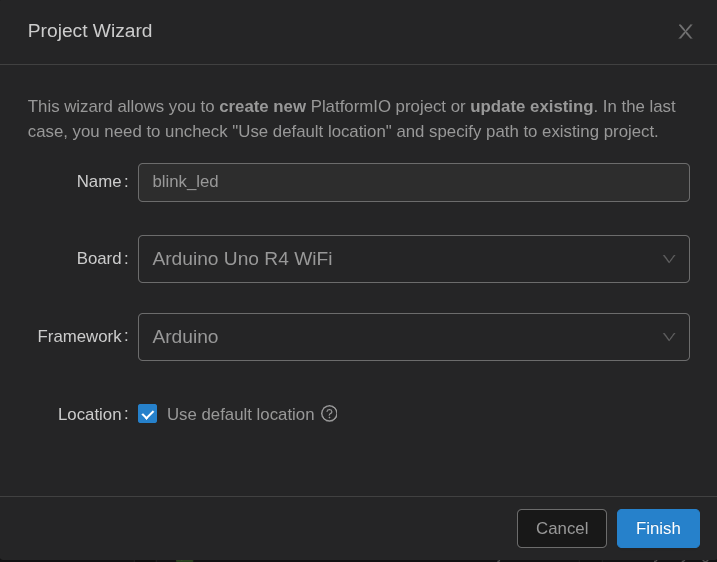
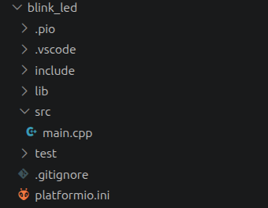

<!--
module_id: basics
author:   David Croft
email:    david.croft@warwick.ac.uk
version: 0.0.1

language: en
narrator: UK English Female

mode: Textbook

title: Basics of Arduino Programming
comment:  This module introduces the structure of Arduino sketches, basic syntax, digital I/O and Serial communications.
long_description: This module covers the Arduino sketch structure, hardware pin control, serial communication, blocking vs non-blocking code, and fundamental patterns for embedded programming.
estimated_time_in_minutes: 45

@learning_objectives  
- Understand Arduino sketch structure (setup and loop)
- Learn basic digital I/O (digitalWrite, digitalRead)
- Understand timing functions (millis, delay)
- Understand basic Serial communications
@end

@style
.flex-container {
    display: flex;
    flex-wrap: wrap; /* Allows the items to wrap as needed */
    align-items: stretch;
    gap: 20px; /* Adds both horizontal and vertical spacing between items */
}

.flex-child { 
    flex: 1;
    margin-right: 20px; /* Adds space between the columns */
}

@media (max-width: 600px) {
    .flex-child {
        flex: 100%; /* Makes the child divs take up the full width on slim devices */
        margin-right: 0; /* Removes the right margin */
    }
}
@end

@version_history 

Previous versions: 

@end

import: https://raw.githubusercontent.com/liaTemplates/AVR8js/main/README.md

import: ../assets/macros.md
-->

# Basics of Arduino and Embedded Programming

@overview

## Arduino Sketch Structure

Every Arduino program (called a **sketch**) has the same basic structure:

```cpp
void setup() 
{
  // Runs once when the Arduino starts
  // Use this to initialize pins, Serial, libraries, etc.
}

void loop() 
{
  // Runs repeatedly after setup() completes
  // Your main program logic goes here
}
```

Think of it this way:

- **setup()**: Constructor - prepare the system
- **loop()**: Main thread - keep running forever


## A Simple Example: Blinking LED

<div id="simple-demo">
  <wokwi-led color="red" pin="11"></wokwi-led>
</div>
```cpp
#include <Arduino.h>             // all the functions, e.g. delay()

constexpr uint8_t LED_PIN { 13 };  // Define pin number

void setup() 
{
  pinMode(LED_PIN, OUTPUT);      // Configure pin 13 as output
}

void loop() 
{
  digitalWrite(LED_PIN, HIGH);   // LED on
  delay(1000);                   // Wait 1 second (1000 milliseconds)
  digitalWrite(LED_PIN, LOW);    // LED off
  delay(1000);                   // Wait 1 second
}
```
@AVR8js.sketch(simple-demo)

This is your first embedded program! Let's break it down:

- `const uint8_t LED_PIN = 13`: Define the pin number as a constant
- `pinMode(LED_PIN, OUTPUT)`: Tell Arduino that pin 13 is an output
- `digitalWrite(LED_PIN, HIGH)`: Send 5V to the pin (LED on)
- `delay(1000)`: Wait 1000 milliseconds
- `digitalWrite(LED_PIN, LOW)`: Send 0V to the pin (LED off)

Different Arduino pins have different capabilities, but almost all of them allow for simple digital reading and writing.
The pins are clearly numbered on the board one of the first things to check if your system is not working is that you are using the pin/s that you think that you are using.

<div class="pass-task">
@boxheader(In the browser)

Run the example, what happens with the LED?

Adjust the example so that it stays on for twice as long as it is off.
</div>


## Real hardware

Simulation is useful for basic testing and learning, but we ultimately need to run our code on actual hardware.
To do this, we must build the code and upload it to our microcontroller.

Microcontroller manufacturers generally provide an Integrated Development Environment (IDE) for their hardware. Arduino is no exception.

The official Arduino IDE is user-friendly and provides the basic features needed to get code onto a board, but it lacks most of the advanced functionality offered by more capable IDEs.

For this reason, we will use Visual Studio Code (VS Code) with the PlatformIO ecosystem for Arduino development, rather than the official Arduino IDE.

Creating your first project
=========================

1. Open VSCode.
2. Open the PlatformIO Home within VSCode.
    - House icon ⌂ on the bottom bar.
    - Or Ctrl+Shift+P, ">PlatformIO: PlatformIO Home"
3. Click on the "+ New Project" button.
4. Create your project.
    - You need to give it a *meaningful* name.
    - Pick the correct board type, i.e. 'Arduino UNO R4 WiFi'
    - You can leave it in the default location or create it somewhere else.
5. In the Explorer window on the left, find and open the 'src/main.cpp' file.
6. Replace the contents of main.cpp with the blinking LED code.
7. Build your code.
    - Using the Build ✓ icon on the bottom bar.
    - Or Ctrl+Shift+P, ">PlatformIO: Build".
    - Make sure it builds successfully.
7. Plug your Arduino into your PC using the USB.
8. Upload the code to your Arduino 
    - Using the Upload → icon on the bottom bar.
    - Or Ctrl+Shift+P, ">PlatformIO: Upload"
    - Make sure it uploads successfully.

If everything has worked, you should be one of the LEDS on your Arduino board blinking.





----------------------------------

In our example code we are using pin 13, this pin does support digital read and write, but it is a bit special in that it come connected to a built in LED as well. 
This makes it especially easy to see the pin's state.

<div class="pass-task">
@boxheader(On the hardware)

If you have not already done so, follow the [ecosystem](../ecosystem/ecosystem.md) instructions.

Upload the Blinking LED example to the Arduino board from your module kit and confirm it works.
</div>


# Serial communications

In order to get better insights into what our code is doing we need to add some log messages.

The Arduino can send text to your PC over the USB cable using the `Serial` object. 
It can also receive text sent from your PC.

How serial works
================

Serial communication sends data one bit at a time over a pair of wires, one for each direction:

- **TX** (transmit): the pin a device sends data out on.
- **RX** (receive): the pin a device listens for data on.

The two devices are connected crosswise: the TX of one goes to the RX of the other, and vice versa. They also share a common ground.

```ascii
 Arduino         PC/other
+--------+      +--------+
| TX  ---+------+-->  RX |
| RX  <--+------+---  TX |
| GND ---+------+--- GND |
+--------+      +--------+
```

Most modern PCs have no TX/RX pins. 
To bridge the gap we use a **USB-to-serial adapter**, which converts between USB and the TX/RX signals a microcontroller understands.

- Many Arduinos or other MCU dev boards have this adapter built in. It is wired to the microcontroller's RX/TX pins, and shows up on your PC as a virtual serial (COM) port.
- Some boards, including the Uno R4, handle USB directly in the microcontroller, so no extra adapter is needed, but it still appears on the PC as a serial port.
- Various adapters (FTDI, CP2102, CH340) can be used to talk to boards that have no built in adapter.

<div class="warning">
On Arduino boards that use an adapter, pin 0 is often (RX) and pin 1 (TX).
This means that you cannot use those pins for other purposes *and* have serial communication.

On the Uno R4, the USB connection is the `Serial` object and pins 0 and 1 are a separate serial port called `Serial1`.
</div>


## Starting serial

Call `Serial.begin()` once in `setup()` to start the connection. 
The number is the **baud rate**, the speed of the connection in bits per second. 
Both ends must use the same speed, 9600 and 115200 are common choices.

```cpp
void setup()
{
  Serial.begin(9600);
}
```

<div class="learn-more">
@boxheader(Learn more)

`.begin()` does have additional configuration options, but assuming that you are just communicating with a PC or another Arduino you'll never need to change them.
</div>


## Sending text

Once we have configured our baud rate we can start sending messages.

`Serial.print()` sends the value as text.
`Serial.println()` does the same and then adds a new line at the end.

This is invaluable for debugging! Always add Serial output when something isn't working so that you can see what is happening in your code.

```cpp
#include <Arduino.h>

void setup()
{
  Serial.begin(9600);
}

void loop()
{
  Serial.print("Uptime (ms): ");   // no new line
  Serial.println(millis());        // new line after the value
  delay(1000);
}
```
@AVR8js.sketch(uptime)

<div class="adv-task">
@boxheader(In the browser)

Run the example.

**Do you notice anything odd about the timestamps being output?**

<script input="submit" default="Answers">
"LIASCRIPT: The timestamps are not exactly 1000ms apart.\n\n`delay` does wait 1000ms, but we also need to consider the time it takes to run the rest of the code when we are considering delays.\n\nIt doesn't matter here, but it can for bigger and/or real applications."
</script>

</div>

------------------------------------

PlatformIO
==========

To see the serial messages output from the Arduino, open the serial monitor in PlatformIO (the plug icon on the bottom bar, or Ctrl+Shift+P, ">PlatformIO: Serial Monitor"). 

<div class="important">
@boxheader(Important)

Make sure that `Serial.begin()` matches your monitor baud rate.
If it doesn't, you wont see anything, or wont see anything intelligible.

We will cover adjusting this later on the module.
</div>

<div class="pass-task">
@boxheader(On the hardware)

Upload the uptime example to your Arduino board and monitor the serial messages in PlatformIO.
</div>

<div class="good-task">
@boxheader(On the hardware)

Adjust the code so that the uptime is output in seconds rather than milliseconds.
</div>

### Formatting

`print()` and `println()` can also format numbers in various ways or output in different bases:

```cpp
Serial.print(value);              // Print raw value
Serial.print(value, HEX);         // Print as hexadecimal
Serial.print(value, BIN);         // Print as binary
Serial.println(3.14, 2);          // Print float with 2 decimal places
```


## Receiving text

We have seen how to send text via serial, but this is a two-way communications link. We can also receive text on our serial connection.

`Serial.read()` returns the next character waiting on the connection and remove it from the buffer.
This is assuming that there *is* a character waiting. 
If there is no character then it returns `-1` instead.

`Serial.available()` returns how many characters received and are waiting to be read. `0` means nothing has arrived.

`Serial.readString()` returns a string containing all the characters available within a timeout. I.e. after whatever is available now plus the next 1000ms.

There are multiple other `Serial` methods, but this is a good opportunity for you to learn about reading [the documentation](https://docs.arduino.cc/language-reference/en/functions/communication/serial/).

No module will (or could) cover every single feature. It is your responsibility to explore the documentation and experiment with the available methods to identify the full capabilities and existing builtin functionality.

```cpp
#include <Arduino.h>

void setup()
{
  Serial.begin(9600);
}

void loop()
{
  if( Serial.available() > 0 )
  {
    const char received = Serial.read();

    Serial.print( "You sent: " );
    Serial.println( received );
  }
}
```
@AVR8js.sketch(simple-echo)

<div class="pass-task">
@boxheader(In the browser)

Type a character into the serial monitor's input box and send it, the simulated Arduino will echo it back.
</div>

<div class="good-task">
@boxheader(On the hardware)

Control the built in LED from the serial monitor:

- Sending `1` turns the LED on.
- Sending `0` turns the LED off.

Print a message confirming each change, e.g. "LED on". Any other character should print "Unknown command".

To send text in PlatformIO, start the serial monitor, click on the monitor and just type.
</div>

<div class="adv-task">
@boxheader(On the hardware)

With a friend, connect your two Arduinos together on pins 0 and 1 and try sending messages between boards.

<script input="submit" default="Hint">
"LIASCRIPT: Remember that on the Uno R4, the serial pins on 0 and 1 are controlled by `Serial1`, not `Serial`."
</script>

<script input="submit" default="Hint">
"LIASCRIPT: Remember that RX needs to connect to TX. Make sure pins 0 and 1 on the first Arduino connect to pins 1 and 0 on the other."
</script>
</div>

<div class="learn-more">
@boxheader(Bytes)

`.available()` does not return the number of letters that are waiting, it returns the number of *bytes*.
Equally `.read()` does not return a letter, it returns the next byte of data.
Assuming that you are using English and what's known as ASCII encoding, 1 letter is 1 byte in size so it does work interchangably for out purposes for the moment.
</div>


# Summary

Best Practices for Embedded Programming
========================================

1. **Use meaningful pin names**: `constexpr uint8_t LED_PIN { 13 };` instead of magic numbers.
    - A magic number is a number in your code that is not explained.
    - I.e. `digitalWrite( 13, HIGH )` is a magic number. What is pin 13?
    - `digitalWrite( LED_PIN, HIGH )` is much clearer.
2. **Use Serial debugging** early and often

Recap
=====

- **Arduino sketches** have setup() and loop() functions
- **digitalWrite/digitalRead**: Control and read logic levels (HIGH/LOW)
- **Serial**: Essential for debugging


