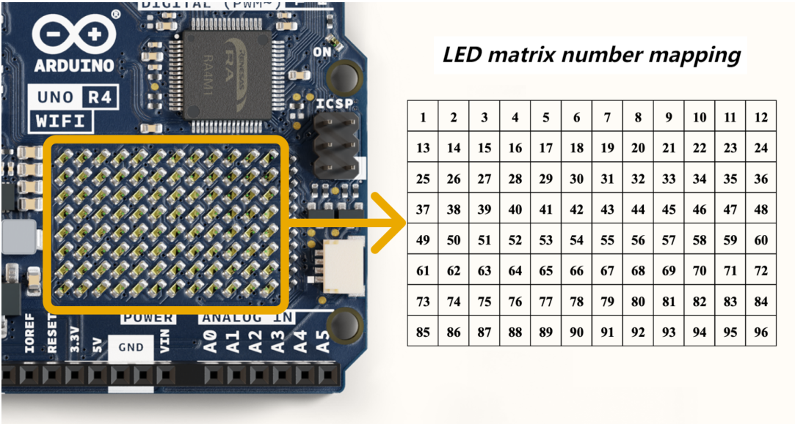

<!--
module_id: bit_twiddling
author:   David Croft
email:    david.croft@warwick.ac.uk
version: 0.0.1

language: en
narrator: UK English Female

mode: Textbook

title: Bit Twiddling
comment:  This module introduces the concepts of bitwise operations and bit fields in embedded systems programming.
estimated_time_in_minutes: 20

@learning_objectives  
- Understand the concept of bitwise operations and their importance in embedded systems.
- Learn how to implement basic bitwise operations in Arduino.
- Gain hands-on experience with using bit fields in Arduino projects.
@end

@style
.flex-container {
    display: flex;
    flex-wrap: wrap; /* Allows the items to wrap as needed */
    align-items: stretch;
    gap: 20px; /* Adds both horizontal and vertical spacing between items */
}

.flex-child { 
    flex: 1;
    margin-right: 20px; /* Adds space between the columns */
}

@media (max-width: 600px) {
    .flex-child {
        flex: 100%; /* Makes the child divs take up the full width on slim devices */
        margin-right: 0; /* Removes the right margin */
    }
}
@end

@version_history 

Previous versions: 

@end

import: https://raw.githubusercontent.com/dscroft/CodeRunner/master/README.md
import: https://raw.githubusercontent.com/liaTemplates/AVR8js/main/README.md

import: ../assets/macros.md

@bit
<script input="checkbox" value="true" output="@0">Number(@input)</script>
@end

@nit
<script input="checkbox" value="false" output="@0">Number(@input)</script>
@end

@bita
<script output="a@0@1">
Number(@input(`@0`) && @input(`@1`))
</script>
@end

@bito
<script output="o@0@1">
Number(@input(`@0`) || @input(`@1`))
</script>
@end

@bitx
<script output="x@0@1">
Number(@input(`@0`) ^ @input(`@1`))
</script>
@end

@bitn
<script output="n@0">
Number(!@input(`@0`))
</script>
@end

@loga
<script>
Boolean(@input(`@0`)) && Boolean(@input(`@1`))
</script>
@end

@logor
<script>
Boolean(@input(`@0`)) || Boolean(@input(`@1`))
</script>
@end

@logx
<script>
let a = Boolean(@input(`@0`));
let b = Boolean(@input(`@1`));
(a && !b) || (!a && b)
</script>
@end

@biti
<script output="i@0@1@2@3">
let val = Number(@input(`@0`))*8 + Number(@input(`@1`))*4 + Number(@input(`@2`))*2 + Number(@input(`@3`))*1;
val;
</script>
@end

@bitb
<script>
"" + @input(`@0`) + @input(`@1`) + @input(`@2`) + @input(`@3`)
</script>
@end

-->


# Background

@overview

## Number bases

A number can be written in different **bases**. The base determines the
digits available and the value of each position. Moving one position to the
left multiplies that position's value by the base.

- **Denary (base 10)** uses the digits `0` to `9`. Its positions represent
  ones, tens, hundreds and so on.
- **Binary (base 2)** uses only `0` and `1`. Each digit is a **bit**, and
  its positions represent powers of two: 1, 2, 4, 8 and so on.
- **Hexadecimal (base 16)** uses `0` to `9` and `A` to `F`, where `A`
  represents ten and `F` represents fifteen. Its positions represent
  powers of sixteen: 1, 16, 256 and so on.

For example, the same value can be written in all three bases:

```ascii
Decimal:      42 = 4 x 10 + 2 x 1
Binary:   101010 = 1 x 32 + 0 x 16 + 1 x 8 + 0 x 4 + 1 x 2 + 0 x 1
Hex:          2A = 2 x 16 + 10 x 1
```

In C++, hexadecimal integer literals start with `0x`, so `0x2A` is denary 42.
Binary integer literals start with `0b`, so `0b101010` is also 42. 
These notations are different ways to specify the same value, not different ways of storing it.

The table compares these bases and base 8 (octal) for values from 0 to 16:

```ascii
Base  2 | 0 | 1 | 10 | 11 | 100 | 101 | 110 | 111 | 1000 | 1001 | 1010 | 1011 | 1100 | 1101 | 1110 | 1111 | 10000 |
Base  8 | 0 | 1 |  2 |  3 |   4 |   5 |   6 |   7 |   10 |   11 |   12 |   13 |   14 |   15 |   16 |   17 |    20 | 
Base 10 | 0 | 1 |  2 |  3 |   4 |   5 |   6 |   7 |    8 |    9 |   10 |   11 |   12 |   13 |   14 |   15 |    16 |
Base 16 | 0 | 1 |  2 |  3 |   4 |   5 |   6 |   7 |    8 |    9 |    A |    B |    C |    D |    E |    F |    10 |
```

<div class="important">
@boxheader(Important)

The key point to understand is that the values and therefore 1s and 0s being stored in memory are the same.
We are only changing the representation of the value, not the actual value.
</div>

<div class="warning">
@boxheader(Warning)

Binary literals ('0b000001` etc) require C++14 or later.
</div>


<div class="pass-task">
@boxheader(In the browser)

Change the code below to output <script run-once="true">Math.floor(Math.random()*101)+10</script>, making sure to specify the value as binary.

```cpp
std::cout << 0b101010 << std::endl;
```
@addcppmain()

</div>

<div class="pass-task">
@boxheader(Question)

**Which values are equal?**

[[X]] `0b1010`, `0xA` and `10`
[[ ]] `0b1010`, `0x10` and `10`
[[ ]] `0b1010`, `0xA` and `16`
***
`0b1010` is eight plus two, and `0xA` is ten. Both represent denary 10.
***
</div>


### Hexadecimal

Hexadecimal is particularly useful when working with bits because one hex digit corresponds to exactly four bits. 
Grouping the binary value from the right, `0010 1010` corresponds to `0x2A`. 
The benefit of working with hex in particular when working with C/C++ is that hexadecimal values neatly align to the underlying bytes.
1 hexadecimal characters exactly equals 4 bits so 2 characters equal 1 byte of data.

Octal has some uses as it neatly to 3 bits.

Denary does not align at all.

```ascii
        <---------- 1 byte -----------> <---------- 1 byte ----------->
       +---+---+---+---+---+---+---+---+---+---+---+---+---+---+---+---+
Binary | 1 | 0 | 1 | 0 | 1 | 0 | 1 | 0 | 1 | 1 | 1 | 1 | 1 | 1 | 1 | 1 | 
       +---+---+---+---+---+---+---+---+---+---+---+---+---+---+---+---+
Octal  | 1 |     2     |     5     |     3     |     7     |     7     |
       +---+---+---+---+---+---+---+---+---+---+---+---+---+---+---+---+
Hex    |       5       |       5       |       F       |       F       |
       +---+---+---+---+---+---+---+---+---+---+---+---+---+---+---+---+
Denary |                             22015                             |
       +---------------------------------------------------------------+
```


## Logic gates

<section class="flex-container">
<div class="flex-child">

In electronics digital circuits use logic gates to combine or invert binary values. 
A `1` represents true (a high signal) and a `0` represents false (a low signal). 
The gate's truth table lists its output for every possible input.

In their most accessible form, they are available in various configurations of a few gates on a single Integrated Circuit (IC).
But in their most numerous form, there are billions of microscopic ones in every CPU/GPU/MCU.

</div>
<div class="flex-child">

, via [Wikimedia Commons](https://commons.wikimedia.org/wiki/File:TexasInstruments_7400_chip,_view_and_element_placement.jpg)")

</div>
</section>

### AND

An AND gate outputs `1` only when both inputs are `1`. For bitwise values, this is the `&` operator.

<section class="flex-container">
<div class="flex-child">

"

</div>
<div class="flex-child">

<!-- data-type="none" -->
| A | B | A AND B |
|:-:|:-:|:-------:|
| 0 | 0 | 0 |
| 0 | 1 | 0 |
| 1 | 0 | 0 |
| 1 | 1 | 1 |

</div>
</section>


### OR

An OR gate outputs `1` when either input or both inputs are `1`. For bitwise values, this is the `|` operator.

<section class="flex-container">
<div class="flex-child">

")

</div>
<div class="flex-child">

<!-- data-type="none" -->
| A | B | A OR B |
|:-:|:-:|:------:|
| 0 | 0 | 0 |
| 0 | 1 | 1 |
| 1 | 0 | 1 |
| 1 | 1 | 1 |

</div>
</section>

### NOT

A NOT gate has one input and inverts it: `0` becomes `1`, and `1` becomes `0`. For an individual bit, this is the `~` operator.

<section class="flex-container">
<div class="flex-child">

")

</div>
<div class="flex-child">

<!-- data-type="none" -->
| A | NOT A |
|:-:|:-----:|
| 0 | 1 |
| 1 | 0 |

</div>
</section>

### XOR (exclusive OR)

An XOR gate outputs `1` when exactly one input is `1`; if both inputs are the same, it outputs `0`. For bitwise values, this is the `^` operator.

<section class="flex-container">
<div class="flex-child">

")

</div>
<div class="flex-child">

<!-- data-type="none" -->
| A | B | A XOR B |
|:-:|:-:|:-------:|
| 0 | 0 | 0 |
| 0 | 1 | 1 |
| 1 | 0 | 1 |
| 1 | 1 | 0 |

</div>
</section>


## Registers

Microcontrollers contain hardware **registers**: small storage locations that programs use to configure peripherals, control outputs and read their state. 
A peripheral register often contains several bits, with each bit controlling or reporting a different setting.

For example, the digital pins are organised into ports, with registers for setting pin direction, writing outputs and reading input levels. 
When using the Arduino API, `pinMode()` configures the direction register, 
`digitalWrite()` changes the appropriate output register bit, and `digitalRead()` reads the appropriate input register bit. 
The API handles the mapping from Arduino pin numbers to the underlying port and bit.

This is how your code interacts with the hardware: by reading and writing
specific memory-mapped register locations. 
Unlike ordinary memory, these
locations are connected to the peripheral pin, so reading or writing them can
observe or change the hardware's behaviour.


<div class="warning">
@boxheader(Warning)

Different Arduino board use different microcontrollers and mappings.

On the Uno R3, the built-in LED is connected to digital pin 13, which is port B bit 5, also called PB5:

- `DDRB` controls whether each port B pin is an input or output.
- `PORTB` controls the output level for pins configured as outputs.
- `PINB` is used to read the pin levels.

On the Uno R4 WiFi, the built-in LED is also connected to digital pin 13, but this is P102 (port 1, pin 2) on the RA4M1 microcontroller.

This means that if you start editing the registers directly you are likely to have problems when moving code between different boards.
One of the reasons that we use like the Arduino API is that it helps to make your code platform agnostic.
So on this module we absolutely recommend that you keep away from direct manipulation of registers even whilst we make you aware of them.

Stick to the `pinMode()`, `digitalRead()`, `digitalWrite()` functions as much as possible.

<div id="register-demo">
  <wokwi-led pin="5"></wokwi-led>
</div>

```cpp AVR Arduino register example
#include <Arduino.h>
#include <avr/io.h>

void setup()
{
  DDRD |= _BV(DDD5); // Configure digital pin 5 as an output
}

void loop()
{
  PORTD ^= _BV(PORTD5); // Toggle digital pin 5
  delay(1000);
}
```
@AVR8js.sketch(register-demo)
</div>


# Bitwise Operations

Bitwise operations have obvious parallels with logical operations and logic gates, i.e. `&&`, `||`, `!`, AND, OR, NOT, and XOR.

- However, bitwise operations work on the individual bits of a variable.

<!-- data-type="none" data-sortable="false" -->
| | Variables | Integer value | Binary representation |
|-:|-|----:|:----:|:----:|
|| `a`      | @biti(a3,a2,a1,a0) | @bit(a3) @bit(a2) @nit(a1) @nit(a0) | 
|| `b`      | @biti(b3,b2,b1,b0) | @bit(b3) @bit(b2) @bit(b1) @bit(b0) |
|| **Operation** | **Integer value** | **Binary representation** |
| Bitwise and | `a & b`  | @biti(aa3b3,aa2b2,aa1b1,aa0b0) | @bita(a3,b3) @bita(a2,b2) @bita(a1,b1) @bita(a0,b0) |
| Bitwise or  | `a | b`  | @biti(oa3b3,oa2b2,oa1b1,oa0b0) | @bito(a3,b3) @bito(a2,b2) @bito(a1,b1) @bito(a0,b0) |
| Bitwise xor | `a ^ b`  | @biti(xa3b3,xa2b2,xa1b1,xa0b0) | @bitx(a3,b3) @bitx(a2,b2) @bitx(a1,b1) @bitx(a0,b0) |
| Bitwise not | `~a`     | @biti(na3,na2,na1,na0) | @bitn(a3) @bitn(a2) @bitn(a1) @bitn(a0) |
|| **Operation** | **Boolean value** |
| Logical and | `a && b` | @loga(ia3a2a1a0,ib3b2b1b0) |
| Logical or  | `a || b` | @logor(ia3a2a1a0,ib3b2b1b0) |
| Logical xor  | `(a && !b) || (!a && b)` | @logx(ia3a2a1a0,ib3b2b1b0) |

<div class="help">
@boxheader(Help)

Remember that logic operations work on boolean values, which means that integers are converted to a boolean first.
In most programming languages 0 is considered false, and all other values are considered true.

Bitwise operations work on the individual bits of an integer's binary representation.
</div>


## Bit masks

A **bit mask** is an integer whose set bits select positions in another
integer. 
Masks let us test or change particular bits without affecting the
others. This is useful when several independent flags are stored together.

The examples below show the low eight bits of an unsigned integer. Bit
positions are numbered from right to left, starting at zero:

<!-- style="max-height: 80px" -->
```ascii
Bit position:  7 6 5 4 3 2 1 0
Value:         0 1 0 1 1 1 1 1   = 0x5F
Mask:          0 0 1 0 1 1 0 0   = 0x2C
Result (AND):  0 0 0 0 1 1 0 0   = 0x0C
```

The mask selects bits 2, 3 and 5. The other bits are not selected.

### Testing bits

AND a value with a mask to retain only the selected bits:

<!-- style="max-height: 80px" -->
```ascii
  01011111  value
& 00101100  mask
----------
  00001100  result
```

For a mask containing multiple bits, there are two useful tests:

```cpp
const uint8_t value = 0b01011111;
const uint8_t mask  = 0b00101100;

std::cout << std::boolalpha;
std::cout << "Any selected bit set: " << ((value & mask) != 0u) << std::endl;
std::cout << "All selected bits set: " << ((value & mask) == mask) << std::endl;
```
@addcppmain()

In this example the mask is looking for bits 2, 3 and 5.
But only bits 2 and 3 are set in the value.
So the first test is `true` as some of the masked bit are set.
The second is `false` as not *all* of the masked bits are set.


### Setting, clearing and toggling bits

Given a value and a mask:

- `value |= mask` sets the selected bits to 1.
- `value &= ~mask` clears the selected bits to 0.
- `value ^= mask` toggles the selected bits: 0 becomes 1 and 1 becomes 0.

For example, to clear the bits of a mask, invert the mask and AND it with the value:

<!-- style="max-height: 140px" -->
```ascii
  00001100  mask 0x0C
  11110011  not mask ~0x0C

  01011111  value: 0x5F
& 11110011  not mask ~0x0C
----------
  01010011  result: 0x53
```

The selected bits become zero; every other bit stays as it was. The
inversion operates on the full unsigned integer, not just the eight bits
shown here.

```cpp
uint8_t flags = 0b01011111;
const uint8_t mask = 0b11110011;

flags &= ~mask;
std::cout << "Clear:  " << std::bitset<8>(flags) << std::endl;

flags |= mask;
std::cout << "Set:    " << std::bitset<8>(flags) << std::endl;

flags ^= mask;
std::cout << "Toggle: " << std::bitset<8>(flags) << std::endl;
```
@addcppmain1(bitset)


`std::bitset<8>` is used here to convert the lowest 8 bits of the variable to a string so that we can print the binary representation.
Otherwise `std::cout` is going to show it as denary.


<div class="adv-task">
@boxheader(Question)

**A value contains `0x5F`. What is its value after clearing the bits selected by `0x0C`?**

[[ ]] `0x0C`
[[X]] `0x53`
[[ ]] `0x5F`
***
`0x5F & ~0x0C` clears bits 2 and 3 while leaving the other bits unchanged.
***
</div>

<div class="adv-task">
@boxheader(On your machine)

Start with `unsigned int flags = 0b0101;`. Using masks, set bit 1, clear
bit 2, then toggle bit 0. Print the result after each step.

Predict the results before running the program. Check that the unselected
bits remain unchanged.

<script input="submit" default="Hint">
"LIASCRIPT: Use | to set, & with ~ to clear, and ^ to toggle. Bit 0 is the rightmost bit."
</script>

<script input="submit" default="Answer">
"LIASCRIPT: The results are 0b0111, 0b0011 and 0b0010, or 7, 3 and 2."
</script>
</div>


## C++ stl

It is worth mentioning that these operators are carried over from C.
With modern C++, if cannot remember the bit operator syntax and you have access to them, there are STL functions to do the same.

See the [documentation](https://en.cppreference.com/cpp/header/functional) for `std::bit_and`, `std::bit_or`, `std::bit_xor` and `std::bit_not`;

```cpp
const uint8_t value = 0b01011110;
const uint8_t mask  = 0b11110010;

std::cout << std::bit_or{}(value, mask) << std::endl;
std::cout << std::bit_and{}(value, mask) << std::endl;

std::cout << std::bitset<8>( std::bit_or{}(value, mask) ) << std::endl;
std::cout << std::bitset<8>( std::bit_and{}(value, mask) ) << std::endl;

```
```cpp -main.cpp
#include <bitset>
#include <cstdint>
#include <iostream>
#include <functional>
int main() { 
  #include "visible.h"
}
```
@LIA.eval(`["visible.h", "main.cpp"]`, `g++ main.cpp`, `./a.out`)
@hidecode("main.cpp")


# Bit shifting

The left-shift operator `<<` and right-shift operator `>>` move the bits of an unsigned integer by a chosen number of positions. 
For example, shifting `00001101` left by one place gives `00011010`; shifting it right by one gives `00000110`. 
Bits that move beyond the end are discarded. Right shifts fill the newly opened positions with zeros.

When the result fits, shifting an unsigned value left by one place is equivalent to multiplying it by 2, while shifting right by one place is equivalent to unsigned integer division by 2. 
More generally, shifting by `n` places multiplies or divides by $2^n$ (division discards any remainder). 

In embedded programs, shifts are especially useful for building bit masks.

<!-- style="max-height: 140px" -->
```ascii
0b00000001 << 0 is 0b00000001
0b00000001 << 1 is 0b00000010
0b00000001 << 2 is 0b00000100
    . . . . . . . . . . . 
0b00000001 << 6 is 0b01000000    
0b00000001 << 7 is 0b10000000
0b00000001 << 8 is 0b00000000
```


```cpp
int var = 1;
for( int i=0; i<sizeof(var)*8; ++i ) // loop over all the bits in var
{
  const int result = var << i;
  std::cout << var << " << " << i << " = " << result << std::endl;
}
```
```cpp -main.cpp
#include <iostream>
int main() { 
  #include "visible.h"
}
```
@addcppmain()

<div class="important">
@boxheader(Important)

Notice that `<<` is used for both the stream insertion operator *and* bit shifting.
This can cause problems if you are trying to bit shift and stream at the same time.

E.g. `std::cout << 1 << 8 << std::endl;`

If you run into this issue, put your bit shift code inside brackets.

I.e. `std::cout << ( 1 << 8 ) << std::endl;`
</div>

<div class="pass-task">
@boxheader(Question)

**For an unsigned int `value = 3`, what is `value << 2`?**

[[ ]] `6`
[[X]] `12`
[[ ]] `32`
***
`0b11` shifted left twice becomes `0b1100`, or 12. 
***
</div>


## Signed/Unsigned

It is worth highlighting that while left shifting behaves the same way for both signed and unsigned integers, the same cannot be said for right shifting. The key difference is that signed integers are stored using two's-complement representation on most systems. 

Two's complement
=================

With signed integers the naive way to represent positive and negative values is to have 1 bit that represents the sign directly. 
E.g. 0 is positive and 1 is negative. So 00000101 could be +5 and 10000101 could be -5.
This approach would have several issues, including that it allows for +0 and -0 and that +0 does not equal -0.

Much more common is to represent the values using two's complement.
In two's complement to convert a number to a negative you take the positive representation, flip all the bits, then add 1.

The top bit still represents the sign, the double 0 issue is avoided.

```cpp
const uint8_t var = 5;

std::cout << " " << static_cast<int>( var )                // print as an int
          << " = " << std::bitset<8>( var )  << std::endl; // display as binary
std::cout << static_cast<int>(-var ) 
          << " = " << std::bitset<8>( -var ) << std::endl;
```
```cpp -main.cpp
#include <cstdint>
#include <bitset>
#include <iostream>
int main() { 
  #include "visible.h"
}
```
@LIA.eval(`["visible.h", "main.cpp"]`, `g++ main.cpp`, `./a.out`)
@hidecode("main.cpp")

-------------------------

The consequence for us of signed values being represented as two's complement is that when you right shift a signed value, the processor often fills the new left-hand bits with copies of the sign bit (arithmetic right shift). This keeps negative numbers negative. For unsigned values, the empty bits are filled with zeros instead.

Because of this, bitwise shifts are often used with unsigned types when a mask or flag field is being manipulated, since the code is then clearer, more predictable and avoids surprises from signed sign extension.

```cpp
const int8_t signed_var =   -42; // typical two's-complement: 11010110
const uint8_t unsigned_var = 42; // typical binary:           00101010

std::cout << "signed_var        = " << static_cast<int>(signed_var)
          << " = " << std::bitset<8>(signed_var) << std::endl;
std::cout << "signed_var >> 1   = " << static_cast<int>(signed_var>>1) 
          << " = " << std::bitset<8>(signed_var >> 1) << std::endl;

std::cout << "unsigned_var      = " << static_cast<int>(unsigned_var)
          << " = " << std::bitset<8>(unsigned_var) << std::endl;
std::cout << "unsigned_var >> 1 = " << static_cast<int>(unsigned_var>>1) 
          << " = " << std::bitset<8>(unsigned_var >> 1) << std::endl;          
```
```cpp -main.cpp
#include <cstdint>
#include <bitset>
#include <iostream>
int main() { 
  #include "visible.h"
}
```
@LIA.eval(`["visible.h", "main.cpp"]`, `g++ main.cpp`, `./a.out`)
@hidecode("main.cpp")


# Uno R4 LED matrix example

Will come back to bitwise operations in a bit, first we are going to look at the LED matrix on your Arduino Uno R4 Wifi board.

This is a 12x8 matrix with individually addressable LEDs.



The matrix can be programmed in a few different ways depending on your requirements. 
For the moment we are going to focus on setting the values of the individual LEDs manually, specifically the different ways in which we can represent the LED information in our source code.

## Library

Using your Arduino, quickly test that the matrix is working. 
The LED matrix is controlled using the [ArduinoLEDMatrix](https://docs.arduino.cc/tutorials/uno-r4-wifi/led-matrix/#api) library.

```cpp
#include "Arduino_LED_Matrix.h"

ArduinoLEDMatrix matrix;

void setup() 
{
  Serial.begin(9600);
  matrix.begin();
}

void loop()
{
  matrix.loadFrame(LEDMATRIX_LIKE);
}
```

<div class="pass-task">
@boxheader(On the hardware)

Run the example on your Arduino.
</div>

### Byte frames

So we can see that we can display images to the matrix but what if we want to specify our own output?

The simplest option is to declare an 8x12 array, with one element for each LED.
This approach makes the image easy to see directly in the source code.

```cpp Byte example
#include "Arduino_LED_Matrix.h"

uint8_t byte_frame[8][12] = 
{
  { 0, 0, 0, 0, 0, 1, 1, 1, 1, 1, 0, 0 },
  { 0, 0, 0, 0, 1, 0, 0, 0, 1, 1, 0, 0 },
  { 0, 0, 0, 1, 0, 0, 0, 1, 0, 1, 0, 0 },
  { 0, 0, 1, 1, 1, 1, 1, 0, 0, 1, 0, 0 },
  { 0, 0, 1, 0, 0, 0, 1, 0, 0, 1, 0, 0 },
  { 0, 0, 1, 0, 0, 0, 1, 0, 1, 0, 0, 0 },
  { 0, 0, 1, 0, 0, 0, 1, 1, 0, 0, 0, 0 },
  { 0, 0, 1, 1, 1, 1, 1, 0, 0, 0, 0, 0 }
};

ArduinoLEDMatrix matrix;

void setup() 
{
  matrix.begin();
}

void loop()
{
  matrix.renderBitmap(frame, 8, 12);
}
``` 

Each `uint8_t` element occupies 8 bits, even though each LED has only two possible states (on or off). 
The array therefore uses 96 bytes (768 bits) to represent 96 bits of actual information.
 
Not really an issue for us with a single frame but imagine you wanted to have an animation, 84 bytes wasted per frame starts to add up quickly on an embedded platform.

<div class="pass-task">
@boxheader(On the hardware)

Adjust the frame to design your own pattern.
</div>


### Integer frames

A much more efficient way to represent the LED states is as individual bits.
Unfortunately there are no 96 bit long integer variables in C/C++ so we will do the next best thing, 3x32 bit integers.

```cpp Int example
#include "Arduino_LED_Matrix.h"

uint32_t uintFrame[3] = 
{
  2863311530,
  2863311530,
  2863311530
};

ArduinoLEDMatrix matrix;

void setup() 
{
  matrix.begin();
}

void loop()
{
  matrix.loadFrame(uintFrame);
}
``` 

Of course this approach does have the disadvantage of not being able to see the image within our code.


<div class="pass-task">
@boxheader(On the hardware)

Adjust the integer values and see how the pattern changes.

In particular try incrementing or decrementing of the the values by 1, you may find it helpful to do this automatically using a loop.
</div>

<div class="good-task">
@boxheader(On the hardware)

Try and adjust the integer values to get a checker board pattern instead of vertical lines.
</div>


### Hex frames

As discussed earlier, we have multiple ways to represent specific integer values.
Given how they align to the underlying bytes, we could use hex or octal notation.

<section class="flex-container">
<div class="flex-child">
```cpp Hexadecimal example
uint32_t hexFrame[3] = 
{
  0xAAAAAAAA,
  0xAAAAAAAA,
  0xAAAAAAAA
};
```

Notice the leading 0x, this tells C/C++ that this is a hexadecimal value. 
</div>

<div class="flex-child">
```cpp Octal example
uint32_t octFrame[3] = 
{
  025252525252,
  025252525252,
  025252525252
};
``` 

Notice the leading 0, this tells C/C++ that this is an octal value.
</div>
</section>

This has the same memory efficiency but still does not allow use to easily visualise the frame information in the code.


### Binary frames

This finally brings up to binary representations. 
If we are dealing with individual bits in C/C++ then why not just work with binary representations?

------------------------------------------

This ultimately means that we can specify our LED matrix frames directly as binary values. Memory efficiency *and* code clarity.
The only remaining issue is that a 12 LED wide matrix does not map cleanly onto 32bit integers. 
We need to use a combination of bit shifting (`<<`) and bitwise or (`|`) or assemble the final values.

```cpp Incomplete binary example
uint32_t binaryFrame[3] = 
{
  0b101010101010           << 20 | 
  0b101010101010           <<  8 | 
  0b10101010, 0b1010       << 28 | // boundary between 2 32bit integers
  0b101010101010           << 16
  // incomplete
};
``` 

<div class="good-task">
@boxheader(On the hardware)

Complete the frame specification using binary values. 

<script input="submit" default="Hint">
"LIASCRIPT: You will need to figure out the correct amount of bit shifting and where the boundaries between integer values are."
</script>

<script id="button" input="submit" default="Answer">
document.getElementById("answer").style.display = "block";
"Answer"
</script>

<div id="answer" style="display: none">

```cpp
uint32_t binaryFrame[3] = 
{
  0b101010101010           << 20 | 
  0b101010101010           <<  8 | 
  0b10101010, 0b1010       << 28 |
  0b101010101010           << 16 |
  0b101010101010           <<  4 |
  0b1010, 0b10101010       << 24 |
  0b101010101010           << 12 |
  0b101010101010           <<  0
};
```
</div>
</div>


# Bit fields

Setting individual bit using bitwise operations and bit shifting does work and it does provide direct control of the smallest pieces of memory. 
However, the resulting code is not particularly readable or comprehensible, it is far too easy to make a small error or to introduce one whilst changing the code.
There are alternative options in C/C++ for addressing individual bits or collections of bits that are much clearer for the programming or maintainer.

Bit fields are a feature that enables programmers to access memory in non-byte-aligned sections or subsections smaller than a byte. 
While rarely used in general programming, bit fields are useful in embedded systems programming for accessing hardware registers that often have specific bits or groups of bits that control different functions.

Bit fields are also useful when working on memory constrained systems if you have multiple small values needing to be stored.


```cpp
// definition of our StatusRegister
struct StatusRegister 
{
    uint8_t enabled : 1;    // bit 0: enable flag
    uint8_t ready : 1;      // bit 1: ready status
    uint8_t error : 2;      // bit 2-3: error flag
    uint8_t mode : 4;       // bits 4-7: operation mode
};

StatusRegister status;
status.enabled = 1; // Set the enable flag
status.ready = 0;   // Clear the ready status
status.error = 0;   // Clear the error flag
status.mode = 15;   // Set the operation mode to 15 (binary 1111)

// Output as binary
std::cout << std::bitset<sizeof(StatusRegister)*8>(*reinterpret_cast<uint8_t*>(&status)) << std::endl;
```
```cpp -main.cpp
#include <bitset>
#include <cstdint>
#include <iostream>
int main() {
    #include "statusregister.h"
    return 0;
}
```
@LIA.eval(`["statusregister.h", "main.cpp"]`, `g++ main.cpp`, `./a.out`)
@hidecode("main.cpp")


The colon in the struct definition separates the field name from its width in bits, not bytes. 
This makes it important to understand what values can fit in fields of different lengths. 
For example, the `enabled` and `ready` fields are each 1 bit wide, so they can only store boolean values (0 or 1). 
The `error` field is 2 bits wide, allowing it to represent values from 0 to 3 (00, 01, 10, 11 in binary).
The `mode` field is 4 bits wide, allowing values from 0 to 15 (a single hexadecimal digit).

Once defined, we can create an instance of the `StatusRegister` struct and manipulate its fields as though it was a regular struct, but under the hood, it is still just a single byte of memory where each field corresponds to specific bits.

In this example, we define a `StatusRegister` struct that represents an 8-bit hardware register. Each member of the struct corresponds to specific bits in the register, allowing us to easily access and manipulate individual bits without needing to perform manual bitwise operations.

The total size of the `StatusRegister` struct is 1 byte (8 bits), so the same amount of memory is used as a single `uint8_t`, but we can access the individual bits in a more intuitive way.

<div class="adv-task">
@boxheader(In the browser)

Adjust the values of the elements of `status` and see how the binary values change as you do so.

What happens if you try and assign a value which will not fit in the number of bits available?

</div>

----------------------------------------

The alternative to bit fields in this example would be to use bitwise operations to manipulate the bits directly, which can be more error-prone and less readable, e.g.:

```cpp
uint8_t status = 0; // Initialize the status register
status |= (1 << 0); // Set the enable flag 
status &= ~(1 << 1); // Clear the ready status
status &= ~(3 << 2); // Clear the error flag (2 bits)
status |= (15 << 4); // Set the operation mode to 15 (binary 1111)
```

<div class="warning">
@boxheader(Warning)

Care needs to be taken when using bit fields, because the C/C++ standard does not guarantee a specific layout for bit-field members in memory. Their ordering, allocation, and padding are implementation-defined and may vary between compilers, ABIs, and architectures.
For example, one implementation may assign bit 0 to the least-significant bit of the underlying storage, while another may order the fields differently or insert padding between them. This can affect how the register is accessed and interpreted.
This is especially important when working with external hardware registers over interfaces such as I2C or SPI, where the register bit order must match the device datasheet exactly. If the mapping is wrong, the software may read or write incorrect bits, leading to subtle hardware faults.

</div>

# Recap

@recap
