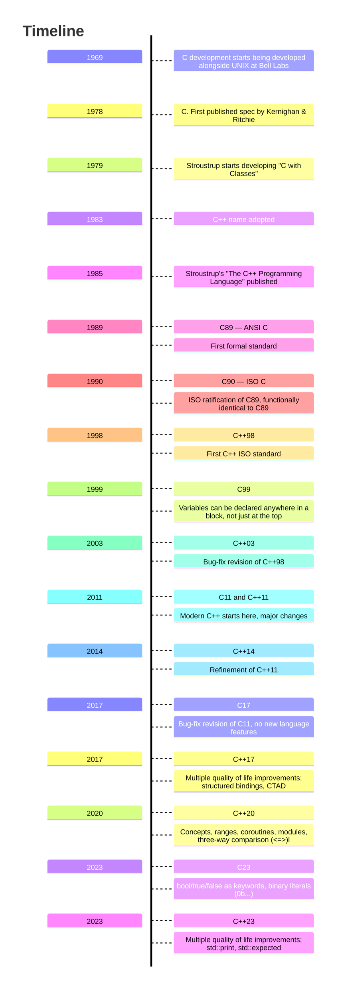
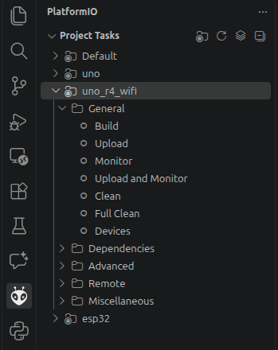
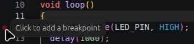

<!--
module_id: build
author:   David Croft
email:    david.croft@warwick.ac.uk
version: 0.0.1

language: en
narrator: UK English Female

mode: Textbook

title: C++ build process
comment:  This module introduces the structure of Arduino sketches, basic syntax, digital I/O, analog I/O, and common patterns.
long_description: This module covers the Arduino sketch structure, hardware pin control, serial communication, blocking vs non-blocking code, and fundamental patterns for embedded programming.
estimated_time_in_minutes: 120

@learning_objectives  
- Understand Arduino sketch structure (setup and loop)
- Learn basic digital I/O (digitalWrite, digitalRead)
- Learn basic analog I/O (analogRead, analogWrite)
- Understand blocking vs non-blocking code patterns
- Learn the Arduino Serial library for debugging
- Understand timing functions (millis, delay)
@end

@style
.flex-container {
    display: flex;
    flex-wrap: wrap; /* Allows the items to wrap as needed */
    align-items: stretch;
    gap: 20px; /* Adds both horizontal and vertical spacing between items */
}

.flex-child { 
    flex: 1;
    margin-right: 20px; /* Adds space between the columns */
}

@media (max-width: 600px) {
    .flex-child {
        flex: 100%; /* Makes the child divs take up the full width on slim devices */
        margin-right: 0; /* Removes the right margin */
    }
}
@end

@version_history 

Previous versions: 

@end

import: https://raw.githubusercontent.com/liaTemplates/AVR8js/main/README.md
import: https://raw.githubusercontent.com/dscroft/mermaid_template/refs/heads/master/README.md
import: https://raw.githubusercontent.com/dscroft/CodeRunner/master/README.md

import: ../assets/macros.md

-->

# C++ build process

@overview

# Compiler flags

So far on the module we have been content to take whatever default settings have been set.
But the behaviour of our compiler and therefore the resulting code can be significantly improved is we move away from the 'most generally convenient' defaults.

## C/C++ versions

One of the most commonly adjusted options is what version of C++ (or C) you are compiling for.
On this module we are assuming that you are using the GNU C Compiler (GCC) in either it's gcc or g++ incarnations.

<div class="learn-more">
@boxheader(Um actually...)

The compiler is GCC. The command to use GCC to compile C code is `gcc`. `g++` is used to compile C++ code using GCC.
Or we can use `gcc -lstdc++` to compile C++. GCC also does fortran with `gfortran` but we are not touching that.

Just use `gcc` for C code and `g++` for C++.
</div>

There are a multiple different versions of both C and C++ which introduces a vast amount of additional functionality and language improvements over the years.
We are going to be focussing on *modern* C++, which means any version after C++11.
Although because we are working on embedded systems, we will need to be aware of *traditional* C++ methods.

To change your C++ version in g++ use the standard flag, e.g. `g++ -std=c++17`




## Optimisation levels

Modern C++ compilers are remarkably capable. 

They analyse code and, depending on the optimisation settings, can simplify expressions, remove unnecessary work, inline functions, and transform loops into efficient machine instructions. 
The generated assembly can look quite different from the source, while still preserving the program's observable behaviour.

This is one reason to favour writing code that is clear and easy to understand. 
Express your intent directly and let the compiler take care of many low-level improvements. 

This works within reason; the compiler cannot fix a poor algorithm or unsuitable data structure, but there is no need to cram multiple actions into a single line.
Write for clarity, measure when performance matters, and manually optimise only when measurements justify it.

```cpp 
#include <iostream>

int main() 
{
  constexpr long long iterations = 100'000'000;
  long long total = 0;
  for( long long i = 0; i < iterations; ++i ) 
  {
    total += 42;
  }
  std::cout << total << std::endl;

  return 0;
}
```
@LIA.evalWithDebug(`["visible.h",["main.cpp","assets/timer.cpp"]]`, `g++ -O0 --std=c++17 main.cpp`, `./a.out`)

⬆ Compile with `-O0`.

```cpp duplicate.cpp
#include <iostream>

int main() 
{
  constexpr long long iterations = 100'000'000;
  long long total = 0;
  for( long long i = 0; i < iterations; ++i ) 
  {
    total += 42;
  }
  std::cout << total << std::endl;

  return 0;
}
```
@LIA.evalWithDebug(`["visible.h",["main.cpp","assets/timer.cpp"]]`, `g++ -O3 --std=c++17 main.cpp`, `./a.out`)
@hidecode("duplicate.cpp")

⬆ Compile with `-O3`

<script style="display: none">
// disable code editting for this slide
document.querySelectorAll('lia-editor').forEach(editor => {
    ace.edit(editor).setReadOnly(true);
});
</script>

<div class="good-task">
@boxheader(In the browser)

See the impact of compiler level optimisation on the runtime of the program.
</div>

<div class="adv-task">
@boxheader(Learn more)

To explore how compiler optimisation level affects the assembly that a compiler produces, visit [Compiler Explorer (Godbolt)](https://godbolt.org/). 
Choose a compiler, compare options such as `-O0` and `-O3`, and watch the generated assembly change as you edit the code.
</div>


## Warnings

Compiler warnings can identify likely mistakes before they become bugs. GCC and compatible toolchains provide several useful warning groups:

- `-Wall` enables a broad set of common warnings. Despite its name, it does not enable every warning.
- `-Wextra` enables additional warnings that are not included in `-Wall`.
- `-Wpedantic` warns about uses of language extensions that do not conform to the selected ISO C or C++ standard. This is useful when portability or strict standard conformance matters.

These options report potential issues without changing the program's behavior, and a warning is not necessarily an error. Read warnings and address those that apply; avoid suppressing them without understanding the cause. The example below intentionally contains two mistakes: the `adjustment` parameter is unused, and the calculated `sum` is ignored. The compiler should warn about both, pointing out a possible logic error as well as an unused parameter. To enable the three options in a PlatformIO project, add them to the relevant environment's `build_flags` in `platformio.ini`:

```cpp 
#include <iostream>

int add( int left, int right, int adjustment ) 
{
  int sum = left + right;
  return left;
}

int main()
{
  std::cout << add(20, 22, 1) << std::endl;
}
```
@LIA.evalWithDebug(`["main.cpp"]`, `g++ -Wall -Wextra -Wpedantic main.cpp`, `./a.out`)

*Compiled with `-Wall -Wextra -Wpedantic`*

<div class="good-task">
@boxheader(In the browser)

Compile the example code with an without warnings, fix the code so that the warnings disappear.

**What else is noticeable about these warnings?**

<script input="submit" default="Answer">
"LIASCRIPT: They weren't all warnings. Or more accurately, we were being warned of an actual error in the code.\n\nThis is why it is a good idea to have warnings turned on. They can help catch errors early."
</script>
</div>


# PlatformIO

PlatformIO projects are managed and configured from the `platformio.ini` in each project. 
PlatformIO reads it to determine which hardware and software toolchain to use, which libraries the project needs, and how to build, upload, and monitor the firmware. 

Each build configuration is called an **environment**. An environment specifies the target `platform` (the PlatformIO supported family of boards), the `board` (the specific board identifier known to PlatformIO), and the `framework` (the software framework, such as `arduino` or `espidf`). 
The board identifier determines board-specific settings such as the upload method and memory layout; it must match a board supported by the selected platform. 
The framework tells PlatformIO which core APIs and framework packages to use.

For example, a project for an Arduino Uno might include:

<section class="flex-container">
<div class="flex-child">
AVR example
===================
```ini
[env:uno]
platform = atmelavr
board = uno
framework = arduino
```
</div>
<div class="flex-child">
Renesas example
=====================
```ini
[env:uno_r4_wifi]
platform = renesas-ra
board = uno_r4_wifi
framework = arduino
```
</div>
</section>

The contents after the : in a `[env:NAME]` block are just a name. 
It does not affect the project configuration, so you can set it to whatever is meaningful to you.

The exact `platform`, `board`, and `framework` values depend on the target platform.

<section class="flex-container">
<div class="flex-child">
Projects can define more than one environment to build the same source code for different boards or platforms. 
The shared `[env]` section provides defaults to all environments, while named sections such as `[env:uno]` and `[env:esp32]` select and configure each target. Settings in a specific environment override the default.
</div>
<div class="flex-child">
```ini
[env]
framework = arduino
monitor_speed = 115200

[env:uno]
platform = atmelavr
board = uno

[env:uno_r4_wifi]
platform = renesas-ra
board = uno_r4_wifi

[env:esp32]
platform = espressif32
board = esp32dev
monitor_speed = 9600
```
</div>
</section>

----------------

The ability to manage for multiple different boards is a distinct benefit for PlatformIO over the default Arduino IDE.
When developing a real system you may well find yourself working across a combination of development and final product boards.
Keeping everything in a single project is a substantial benefit for your workflow and version control.

<div class="important">
@boxheader(Important)

Pressing the build/upload/monitor buttons when you have multiple environments specified may not have the result you expect.

- Build for example will build for *each* environment.
- Upload will upload to the first environment.

To a specify an environment, either:

- Use the individual commands available in the PlatformIO side bar.
- Select the specific environment on the bottom bar.
  - Will say "Default" by default. Click and change.
- Set a `default_envs` option in your `[env]` block.
  - E.g. `default_envs = uno_r4_wifi`


</div>


## Dependencies

Most substantive projects use reusable libraries rather than implementing every feature themselves. 
Dependency management lets a project declare the libraries it needs so PlatformIO can resolve and install them during a build. 
Libraries can be managed for each project and environment, helping keep one project's requirements from interfering with another's.

The PlatformIO Registry is the most convenient option for including libraries.
You can search for libraries, read their documentation, and find the identifier that you are going to need to use in your `platformio.ini` file. 
You can search from the **Libraries** section of PlatformIO Home in VSCode or browse the [PlatformIO Registry](https://registry.platformio.org). 

If the library is *not* available via the registry, PlatformIO also supports dependencies from Git repositories and local or remote archives and folders.

Declare common libraries in `[env]` and libraries needed by only one target in that target's `[env:NAME]` section. A named environment that defines its own `lib_deps` overrides the common list.

For full details, read the [documentation](https://docs.platformio.org/en/latest/librarymanager/dependencies.html)

```ini
[env]
platform = atmelavr
board = uno
framework = arduino
lib_deps =
    adafruit/Adafruit GFX Library
    adafruit/Adafruit BusIO

[env:uno]

[env:uno_debug]
lib_deps =
    ${env.lib_deps}
    bblanchon/ArduinoJson @ ^6.19.4
```

<div class="warning">
@boxheader(Warning)

Prefer the registry's owner/name identifier to avoid ambiguity between libraries with similar names. 
Where practical, specify a version constraint so builds do not unexpectedly pick up incompatible updates.

Dependency choices also have security implications. Package ecosystems have seen compromised releases and malicious look-alike packages published under names that closely resemble trusted libraries.
Giving a precise name and version helps, but they do not guarantee that a dependency is trustworthy.
</div>


## Compiler flags

In PlatformIO, compiler options we discussed at the start are usually set with `build_flags` in `platformio.ini`. For example, to select a C++ standard and enable a compiler optimisation level:

```ini
[env]
build_flags =
     -std=gnu++17
     -O2
```

The `[env]` section supplies defaults to all environments in that project. An environment can set its own `build_flags` when it needs different options; take care that doing so may replace the shared list. To add to the common flags, use PlatformIO's configuration interpolation, for example:

```ini
[env]
build_flags =
     -std=gnu++17
     -O2

[env:uno]
build_flags = ${env.build_flags} 
     -Wall 
     -Wextra 
     -Wpedantic
```

To share defaults across **multiple projects**, put the common settings in a separate INI file, such as `~/platformio/shared.ini`. Then include that file from each project's `platformio.ini`:

```ini
[platformio]
extra_configs = /home/your-user/platformio/shared.ini
```

# Debugging

Embedded debugging can use several approaches. 
Start with observable behavior: check power and wiring, inspect compiler and upload messages, and log important values over a serial console. 
LEDs, GPIO signals can be measured with a logic analyzer or oscilloscope.

But all of these options observe the system from an external vantage.

Debugger
========

In simple terms, a debugger is like a pause button for a program. 
You can stop it, look at what it is doing, and move through its instructions one step at a time to find problems.

A source-level debugger adds breakpoints, single-stepping, and memory inspection tools.
It allows us to observe which line is running and the status of any variables.
But requires compatible hardware and software.

An external debug probe connects to a target's debug interface (such as SWD or JTAG) and to a computer, where a debugger can halt the processor and inspect its state. 
A probe may add cost, and setup can require wiring, drivers, and board-specific configuration. 
The microcontroller has to support that debug interface, not every board or chip supports source-level debugging.

AVR debugging
==============

For many classic AVR-based Arduino boards, a software stub such as [avr-stub](https://docs.platformio.org/en/stable/plus/debug-tools/avr-stub.html) can provide debugging over a serial connection without a dedicated hardware probe. 
It uses the AVR's serial connection to exchange debugger information.
So unfortunately it means that the same connection cannot simultaneously carry normal `Serial` output: both uses would compete for the same pins and data stream, and log text would interfere with the debugger protocol. 

It is however a useful tool for many Arduino boards.

Renasa-Ra debugging
===================

A significant factor in picking the **Arduino UNO R4 WiFi** as the platform for this module is that it provides an onboard debugging option via a built in CMSIS-DAP debug adapter.
For the Uno R4, all communication is handled via USB without affecting the `Serial` output.
This makes this board extremely easy to debug.


## PlatformIO debugging

So how do we actually use the debugger in PlatformIO and VSCode?
This is assuming that you are debugging an Uno R4 Wifi, if it's a different board then the steps will be similar but not identical.

1. Configure your project. We need to inform PlatformIO what debugger to use.
  - At a minimum you need `build_type = debug`.
  - We need `debug_tool = cmsis-dap` for the R4 Wifi but this will change for other boards.
  - I also recommend `debug_init_break = tbreak setup`, which automatically stops code when you get to the `setup()` function.
2. Make sure your Arduino is plugged in.
3. Open your source code and add a breakpoint.
    - Left click just to the left of the line numbers for one of your lines of code. 
4. Run the debugger.
  - You have the 'Run and Debug` button in the Activity Bar on the left.
  - Or Ctrl+Shift+D.
  - Or Ctrl+Shift+P, '>Debug: Start Debugging'
  - Or F5.
5. It's going to take a second to start.
  - You should see the control bar when it's ready 
  - If it doesn't try replugging your Arduino board and running again.


<div class="learn-more">
@boxheader(Learn more)

Compiling code in debug mode does a number of things to the compiled code:

- Includes additional information for the debugger.
  - So that it knows which assembly instructions correspond to which lines of C++ code.
  - The human readable names of the variables, not just the memory locations.
- Probably disables code optimisation, i.e. `-O0`.
  - Can't step through you code line by line if the compiler has removed lines as unnessicary.

The end result is that debug mode code will generally be larger and run slower than release mode code.
This can cause problems, e.g. if your code uses timers or does heavy processing.

But on the other hand if you are debugging your code line by line it's because it isn't working at the moment, so frankly performance is the least of your concerns.
</div>

## Controlling the debugger

Once the debugger is up and running, we have various options stepping through our code.

- **Continue/Pause**, **Restart** and **Stop**.
  - Pretty self explanatory.
- **Step Over**
  - Runs the current line and pauses at the next line. 
  - If the line calls another function, the debugger runs that function without stopping inside it.
- **Step Into**
  - Runs the current line and, if it calls another function, pauses at the first line of that function so you can follow its execution.
- **Step Out**
  - Continues running until the current function returns, then pauses in the function that called it.

## Inspecting in the debugger

To visualise what's happening in our code, in the Debug side bar we going to be mostly concerned with:

- 'Variables': Showing the current values of all active variables in our program.
  - We can even edit the values whilst the program is running/paused.
- 'Watch': These are any specific variables that we have stated we want to observe.
  - You can also write your own expressions in you want to view variables in different formats
- 'Call Stack': Shows the current call stack.
  - I.e. what is the currently running function and which function called the current function.
  - And which function called the calling function.
  - And which function called that function, etc etc etc.

<div class="good-task">
@boxheader(On the hardware)

Take one of your previous programs and configure the project for debugging.

Add at least one breakpoint.

Run the debugger and step through code line by line until you are confident in the controls.
</div>


### Conditional breakpoints

A normal breakpoint pauses every time execution reaches its line. 
A conditional breakpoint pauses only when a condition you specify evaluates to true. 
This is useful inside a loop or frequently called function when you want to inspect a particular case without repeatedly stopping and continuing.

To set one in VS Code, add a breakpoint by clicking beside the line number, then right-click its breakpoint marker and choose **Edit Breakpoint**. 
There are different types of conditional breakpoint, but let's focus on 'Expression' breakpoints.
These allow you to specify conditions using the variables in scope, for example `i == 10` to stop only on the 11th iteration of a for loop.

<div class="good-task">
@boxheader(On the hardware)

Take the following example code and configure a new project for debugging.

- Add in the missing sections.
- Add a conditional breakpoint on the `analogWrite` line to trigger when the code >50%.

```cpp
void loop()
{
  static int percentage = 0;

  // convert 0-100% to 0-255 power scale
  const int pwr = static_cast<int>(100.f/255.f * percentage)
  analogWrite(LED_BUILTIN, pwr);

  Serial.print(percentage++);
  Serial.println("%");

  delay(10);
}
```

<script input="submit" default="Hint">
"LIASCRIPT: You need to add the `setup()` function, set the `Serial` baud rate and set the `pinMode()` for `LED_BUILTIN`."
</script>

<script input="submit" default="Hint">
"LIASCRIPT: You need to add the debug and debugging lines to your `platformio.ini` file.
</script>

<script input="submit" default="Hint">
"LIASCRIPT: On the `analogWrite()` line set and 'Expression' breakpoint to 'percentage > 50'."
</script>
</div>

<div class="adv-task">
@boxheader(On the hardware)

Take your percentage code and clamp the pwr value so that it doesn't exceed 100%.

Add breakpoints so you can easily observe your code when it approaches 100% and confirm that it doesn't go over.
</div>


# Recap

@recap
