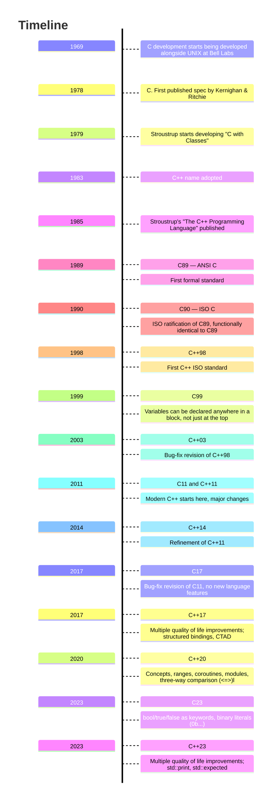

<!--
module_id: build
author:   David Croft
email:    david.croft@warwick.ac.uk
version: 0.0.1

language: en
narrator: UK English Female

mode: Textbook

title: C++ build process
comment:  This module introduces the structure of Arduino sketches, basic syntax, digital I/O, analog I/O, and common patterns.
long_description: This module covers the Arduino sketch structure, hardware pin control, serial communication, blocking vs non-blocking code, and fundamental patterns for embedded programming.
estimated_time_in_minutes: 45

@learning_objectives  
- Understand Arduino sketch structure (setup and loop)
- Learn basic digital I/O (digitalWrite, digitalRead)
- Learn basic analog I/O (analogRead, analogWrite)
- Understand blocking vs non-blocking code patterns
- Learn the Arduino Serial library for debugging
- Understand timing functions (millis, delay)
@end

@style
.flex-container {
    display: flex;
    flex-wrap: wrap; /* Allows the items to wrap as needed */
    align-items: stretch;
    gap: 20px; /* Adds both horizontal and vertical spacing between items */
}

.flex-child { 
    flex: 1;
    margin-right: 20px; /* Adds space between the columns */
}

@media (max-width: 600px) {
    .flex-child {
        flex: 100%; /* Makes the child divs take up the full width on slim devices */
        margin-right: 0; /* Removes the right margin */
    }
}
@end

@version_history 

Previous versions: 

@end

import: https://raw.githubusercontent.com/liaTemplates/AVR8js/main/README.md
import: https://raw.githubusercontent.com/dscroft/mermaid_template/refs/heads/master/README.md
import: https://raw.githubusercontent.com/dscroft/CodeRunner/master/README.md

import: ../assets/macros.md

-->

# Basics of Arduino and Embedded Programming

@overview

## C/C++ versions




# Compiler flags

### Optimisation levels

Modern C++ compilers are remarkably capable. 
They analyse code and, depending on the optimisation settings, can simplify expressions, remove unnecessary work, inline functions, and transform loops into efficient machine instructions. 
The generated assembly can look quite different from the source, while still preserving the program's observable behaviour.

That is one reason to favour code that is clear and easy to understand. 
Express your intent directly and let the compiler take care of many low-level improvements. 
This works within reason: the compiler cannot fix a poor algorithm or unsuitable data structure, and performance can depend on the target hardware. 
Measure when performance matters, and make code more complicated only when measurements justify it.


```cpp 
#include <iostream>

int main() 
{
  constexpr long long iterations = 100'000'000;
  long long total = 0;
  for (long long i = 0; i < iterations; ++i) {
    total += 42;
  }
  std::cout << total << std::endl;

  return 0;
}
```
@LIA.evalWithDebug(`["visible.h",["main.cpp","assets/timer.cpp"]]`, `g++ -O0 --std=c++17 main.cpp`, `./a.out`)

⬆ Compile with `-O0`.

```cpp duplicate.cpp
#include <iostream>

int main() 
{
  constexpr long long iterations = 100'000'000;
  long long total = 0;
  for( long long i = 0; i < iterations; ++i ) 
  {
    total += 42;
  }
  std::cout << total << std::endl;

  return 0;
}
```
@LIA.evalWithDebug(`["visible.h",["main.cpp","assets/timer.cpp"]]`, `g++ -O3 --std=c++17 main.cpp`, `./a.out`)
@hidecode("duplicate.cpp")

⬆ Compile with `-O3`

<script style="display: none">
// disable code editting for this slide
document.querySelectorAll('lia-editor').forEach(editor => {
    ace.edit(editor).setReadOnly(true);
});
</script>

<div class="good-task">
@boxheader(In the browser)

See the impact of optimisation level on the runtime of the program.
</div>

<div class="advances-task">
@boxheader(Learn more)

To explore how optimisation levels affect the assembly that a compiler produces, visit [Compiler Explorer (Godbolt)](https://godbolt.org/). 
Choose a compiler, compare options such as `-O0` and `-O3`, and watch the generated assembly change as you edit the code.
</div>


# Recap

@recap

