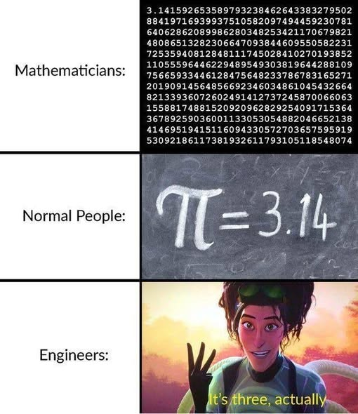

<!--
module_id: cpp_foundations
author:   David Croft
email:    david.croft@warwick.ac.uk
version: 0.0.1

language: en
narrator: UK English Female

mode: Textbook

title: C++ Foundations
comment:  This module introduces the fundamentals of C++ programming, including variables, data types, and control structures.
long_description: This module introduces the fundamentals of C++ programming, including variables, data types, and control structures.
estimated_time_in_minutes: 20


@learning_objectives  
- Understand the concept of C++ variables and data types.
- Learn how to implement basic C++ programming constructs in Arduino.
- Gain hands-on experience with using C++ features in Arduino projects.

@end

@style
.flex-container {
    display: flex;
    flex-wrap: wrap; /* Allows the items to wrap as needed */
    align-items: stretch;
    gap: 20px; /* Adds both horizontal and vertical spacing between items */
}

.flex-child { 
    flex: 1;
    margin-right: 20px; /* Adds space between the columns */
}

@media (max-width: 600px) {
    .flex-child {
        flex: 100%; /* Makes the child divs take up the full width on slim devices */
        margin-right: 0; /* Removes the right margin */
    }
}
@end

@version_history 

Previous versions: 

@end

import: https://raw.githubusercontent.com/dscroft/mermaid_template/refs/heads/master/README.md
import: https://raw.githubusercontent.com/dscroft/CodeRunner/master/README.md
import: https://raw.githubusercontent.com/liaTemplates/AVR8js/main/README.md
import: ../assets/macros.md
-->

# Minimum viable program

Your standard C or C++ program has certain minimal requirements, namely a `main` function.

```cpp
int main()
{
  return 0;
}
```

This a minimal C or C++ program, it does not actually achieve anything, but it does compile and run.

When you run your compiled program, it is the `main` function that is called to start doing whatever it is your program was written to do.
Returning `0` at the end of our `main` indicates that it successfully completed.
Returning other values generally indicates some sort of error, with different errors corresponding to different values.


## Printing to the console

For our simple programs we are going to want to be able to see the values of our variables and what out program is doing.
The simplest way to do this is to print to the console, adding any kind of Graphical User Interface (GUI) to our program dramatically raises the complexity so we will ignore that for now.

How you print to the console depends on whether you are using C or C++.

--------------------------------------

C and stdlib
============
<section class="flex-container">
<div class="flex-child" style="min-width: 450px">
```c
#include <stdio.h>

int main()
{
  printf( "Hello World!\n" );
  return 0;
}
```
@LIA.c()
</div>
<div class="flex-child">
- Here we are using the `printf` function from the Standard Input/Output (stdio library).
  - stdio will not always be available for your C program to use, but that would be very rare.
- At the end of our message we are include a newline (`\n` character).
  - This is required if we want our console to start a new line.
</div>
</section>

--------------------------------------

C++ and std
===========
<section class="flex-container">
<div class="flex-child" style="min-width: 450px">

```cpp
#include <iostream>

int main()
{
  std::cout << "Hello World!" << std::endl;
  return 0;
}
```
@LIA.cpp()
</div>
<div class="flex-child">
- Here we are using the Input/Output stream (iostream) library which forms part of the Standard Template Library (STL) for C++.
  - The STL will not always be available for your C++ program to use.
- Here we are printing to console output `std::cout`.
- Instead of a newline character we are ending with an end of line (`std::endl`).
  - This includes a `\n` but may also include a carridge result character `\r`.
  - `std::endl` also flushes the buffer, which can have performance implications but means that the message is shown immediately.
- It is worth noting that C++ can use C-style code as well.
  - So you could use `printf` if you wanted.
</div>
</section>

--------------------------------------

As we can see, we get exactly the same result from both programs. 
There will normally be multiple routes to the same result when programming. 
One of the key skills that you need to be able to develop is to consider and identify the optimal approach to your end result.

# Variables

In standard C/C++ there are five main variable types.

- `bool` - A value of `true` or `false`, typically 8 bits in size.
- `int` - A signed integer, i.e. + or -.
- `float` - A single-precision floating-point number.
- `double` - A double-precision floating-point number.
- `char` - A single character..

---------------------------------------------

A number of other variable types are also available, such as `long`, `short` or `unsigned int`, which provide different ranges and sizes for integers. 


### Floats and doubles

Both `float` and `double` store approximate real-number values, including
fractions. A `double` generally provides more precision and a wider range than
a `float`. On systems using the common IEEE 754 formats, their typical
characteristics are:

| Type | Typical size | Approximate decimal precision | Approximate range |
|---|---:|---:|---:|
| `float` | 32 bits | 6–7 significant digits | about `1.2e-38` to `3.4e38` |
| `double` | 64 bits | 15–16 significant digits | about `2.2e-308` to `1.8e308` |

These are typical values, not guarantees for every platform. Precision means
the number of significant digits that can be represented reliably; it does not
mean the number of digits after the decimal point. For example, a floating-point
value can represent very large numbers, but with fewer significant digits of
detail.

When specifying a real-number value, by default in C/C++ you get a double.
If you explicitly want a float then add `f` or `F` to the end.

```cpp
float approximatePi = 3.14159f;            // float literal
double morePrecisePi = 3.141592653589793;  // double literal
double alsoPi = 3.14159;  // Unsuffixed literals are double by default.
float evenMorePi = 3.141592653589793;  // double literal but truncated when stored in a float
```

The suffix also applies to scientific notation, for example `1.5e3f`. 
Choose `double` when you need its greater precision or range; use `float` when its
smaller storage requirement is useful and its precision is sufficient.


### Bools

The `bool` type represents a truth value and can hold either `true` or
`false`. 

Comparisons produce `bool` results, so they can be assigned to a variable or
used directly in a condition:

When printed, they are typically displayed as number as a number.
`false` converts to `0` and `true` to `1`.
Use `std::boolalpha` with `std::cout` to display the words instead.

```cpp
int temperature = 22;
temperature > 20;  // true

std::cout << ( temperature > 20 ) << std::endl;

std::cout << std::boolalpha;
std::cout << ( temperature > 20 ) << std::endl;
```
@addcppmain()


## Variable ranges and sizes

In C and C++, the variable type being used can have a major impact on the limits of the values that can be stored.
Far more so than many other languages.

<section class="flex-container">
<div class="flex-child" style="min-width:400px">
Python
=======

```py
big_number = 1.23e20
print(format(big_number, '.0f')) 
```
@LIA.python()
</div>
<div class="flex-child" style="min-width:400px">
C++
=====

```cpp
int big_number = 1.23e20;
std::cout << big_number << std::endl;
```
@addcppmain()
</div>
</section>

<div class="pass-task">
@boxheader(Question)

**What happens when you try and store a very large number in a C/C++ integer?**

[( )] It automatically prints 0.
[(x)] The result is wrong/smaller.
[( )] The compiler always prevents the program from compiling.
[( )] Integer types can store numbers of any size.
*********************************************
Integer types can represent only values within a limited range. In the example above, converting `1.23e20` to `int` is out of range, so the behavior is undefined.
  
In the example code it gets capped at the maximum value that int can store, but this is not guaranteed on all systems.
*********************************************
</div>

---------------------------------

| Type | Example Size | Min | Max |
|---:|---:|------:|------:|
| short              | 16 bits | -32,768          | 32,767           |
| unsigned short     | 16 bits | 0                | 65,535           |
| int                | 32 bits | -2,147,483,648   | 2,147,483,647    |
| unsigned int       | 32 bits | 0                | 4,294,967,295    |
| long               | 32 bits | -2,147,483,648   | 2,147,483,647    |
| unsigned long      | 32 bits | 0                | 4,294,967,295    |
| long long          | 64 bits | -9,223,372,036,854,775,808 | 9,223,372,036,854,775,807 |
| unsigned long long | 64 bits | 0                | 18,446,744,073,709,551,615 |

<div class="important">
@boxheader(Important)

The size and therefore range of variables in C/C++ can change depending on the hardware platform and compiler being used.

But numbers shown in the table above and pretty standard for an 32 bit system, or x86_64 architecture which is what most PCs run.
</div>


### `sizeof`

If you are unsure about the size of a variable type on your platform, you can use the `sizeof` operator to determine the size in bytes.

```cpp
std::cout << "Size of int:     " << sizeof(int)     << " bytes" << std::endl;
std::cout << "Size of float:   " << sizeof(float)   << " bytes" << std::endl;
std::cout << "Size of bool:    " << sizeof(bool)    << " bytes" << std::endl;
std::cout << "Size of char:    " << sizeof(char)    << " bytes" << std::endl;
std::cout << "Size of int16_t: " << sizeof(int16_t) << " bytes" << std::endl;
```
@addcppmain1(cstdlib)

Note that C/C++ variables will have a size in whole bytes, and so the size of a variable will always be a multiple of 8 bits.
These applies even for variables that could be represented with fewer bits, such as a `bool` which only needs 1 bit to represent its two possible values, but will typically be stored in a full byte (8 bits).


## Fixed sizes

The exact size of variables takes on additional significance for embedded development due to the limited space available and hardware interfaces.

- Why use a 4 byte `int` to store pin numbers when pins only go up to 19 and we could do it with 1 byte?
- Some sensors return 32 bit results (e.g. AEDR-9920 or LS7366R encoder counters), we don't want to accidentally drop information because our `int` is only 16 bits on a given architecture

---------------------

The other concern is that many of these types can change their sizes (and therefore the maximum and minimum values they can store) depending on the architecture they were compiled for.
The reason that C/C++ does this is to help in the creation of optimal code for any given system.
But it is also very annoying when your code breaks when you move it to a different MCU.

For example on an AVR Arduino (an 8 bit system), `int` will be 16 bits long, capable of storing values between -32,768 and 32,767.
But on a Renasas Arduino (a 32 bit system), `int` is 32 bits and capable of storing -2,147,483,648 to 2,147,483,64.

So, for situations were the exact size matters, we also have fixed width integer types.

<!-- data-type="none" -->
| Type | Size | Min | Max | |
|---:|---:|------:|------:|---------|
|  `int8_t` | 8 bits | -128 | 127 |
| `uint8_t` | 8 bits |    0 | 255 | Also called `byte` on Arduino. |
| `int16_t` | 16 bits | -32,768 | 32,767 |
| `uint16_t` | 16 bits | 0 | 65,535 |
| `int32_t` | 32 bits | -2,147,483,648 | 2,147,483,647 |
| `uint32_t` | 32 bits | 0 | 4,294,967,295 |
| `int64_t` | 64 bits | -9,223,372,036,854,775,808 | 9,223,372,036,854,775,807 |
| `uint64_t` | 64 bits | 0 | 18,446,744,073,709,551,615 |


## Initialisation

C++ variable initialisation has traditionally been accomplished using the `=` (assignment) operator. 

For example:

```cpp
#include <iostream>

int main()
{
    int pi = 3.1415;
    std::cout << pi << std::endl;
}
```
@LIA.cpp()

<div class="pass-task">
@boxheader(Question)

**What is the issue with this code?**

    [( )] Pi value is not precise enough.
    [( )] ????
    [(x)] Not possible to store pi in an int.
*********************************************
As integers can only store whole numbers they are unable to accurately represent floating point numbers like pi. 
To solve this we need to use a different data type.
*********************************************
</div>


### Brace Initialisation

With the introduction of the C++11, it is now possible to use brace-initialisation (`{}`).

Brace initialisation has multiple possible advantages but the key one for us at this stage is a compile time check for narrowing conversions.
I.e. if you try to assign a value that cannot be represented exactly by the type of the variable, the compiler will generate an error.
    
For example:

```cpp
#include <iostream>

int main()
{
  int pi { 3.1415 };
  std::cout << pi << std::endl;
}
```
@LIA.cpp()


### Uninitialised variables

In C and C++, if you declare a variable without initialising it, its value is **indeterminate**. 

This means the variable will contain whatever "garbage" value happened to be left in that memory location from previous operations. Using an uninitialised variable leads to **undefined behavior**, which can result in:

1. **Unpredictable Program Logic:** 
    - Your code may work correctly on your machine but fail unexpectedly on another, or even crash randomly over time.
2. **Security Vulnerabilities:** 
    - Insecure data leakage or exploitable conditions based on random memory contents.
3. **Hard-to-Debug Errors:** 
    - Because the value depends on previous memory state, the bug may be intermittent and difficult to reproduce.

Always initialise your variables when you declare them, unless you are *certain* they will be assigned a valid value before being read.

```cpp
int counter;          // Uninitialised - contains garbage?
int safeCounter = 0;  // Initialised - explicitly set to zero
```

<div class="pass-task">
@boxheader(Question)

**What happens if you try to print the value of an uninitialised integer variable in C++?**

    [( )] It automatically prints 0.
    [(x)] It may print a garbage value (indeterminate content).
    [( )] The compiler prevents it from running forever.
    [( )] It causes a syntax error during compilation.
*********************************************
C++ does not guarantee that variables are zeroed out by default for performance reasons. 
An uninitialised local variable may contain whatever data was previously stored in that memory address, leading to unpredictable results. 
Always initialise your variables!
*********************************************
</div>

-------------------------------

Uninitialised variables can have surprising consequences. 
For example in the code below we fail to initialise the `var` variable in each iteration of the loop.

```cpp
#include <iostream>

void func1()
{
	int i = 42;
}

void func2()
{
  int var;
	std::cout << var << std::endl;
}

int main()
{
  func1();
  func2();
    
  return 0;
}
```
@LIA.cpp()

<div class="good-task">
@boxheader(Question)

**Why does `func2()` print 42?**

[( )] Because thats the default value for an integer.
[( )] Because previous values are automatically cleared from memory before use.
[(x)] Because `var` is uninitialised, so it contains whatever value was previously in that memory.
[( )] Because `var` increments by default.
*********************************************
Local variables declared inside a function (without `static`) are created on the stack each time the function is called. 
`func1()` is called first and stores an integer in stack memory containing the value 42.
When it ends, `func1()` returns the stack but it doesn't wipe the contents.
Since `func2()` does not initialise its variable, it simply reads whatever bits were previously left in that stack location by `func1()`.
*********************************************
</div>


## Overflow and underflow

When a variable exceeds its maximum value, it (may) wrap around to the minimum value (overflow) and when it goes below its minimum value, it wraps around to the maximum value (underflow).

```cpp
int myInt = std::numeric_limits<int>::max();
unsigned int myUInt = std::numeric_limits<unsigned int>::max();

std::cout << "myInt:  " << myInt << std::endl;
std::cout << "myUInt: " << myUInt << std::endl;

myInt  = myInt  + 1; // cause overflows
myUInt = myUInt + 1;

std::cout << "myInt after overflow:  " << myInt << std::endl;
std::cout << "myUInt after overflow: " << myUInt << std::endl;
```
@addcppmain1(limits)

<div class="important">
<b style="color: rgb(var(--color-highlight));">Important note</b><br>

This overflow and underflow behaviour is extremely common and a large quantity of code has been written that relies on this behaviour.
However, there is nothing in the C or C++ standards that requires this behaviour, and so it is technically possible for a platform to implement a different behaviour for overflow and underflow, such as saturating at the maximum or minimum value instead of wrapping around.

Simply because this behaviour is common and works on most compilers and platforms does **not** mean that it is guaranteed to work on all compilers and platforms, and so it is important to be aware of this when writing code that may be compiled for different targets.
</div>


## Read-only variables

Variables are mutable by default: their values can be changed after they are
created. Sometimes a value should stay fixed. In C/C++, use the `const` qualifier
to make a variable read-only after initialization.

<div class="learn-more">
@boxheader(Learn more)

Traditionally, most programming languages, including C and C++, have adopted a mutable-by-default approach, allowing variables to be modified after they have been initialised.

More modern languages, such as Rust, have moved towards an immutable-by-default approach, where variables cannot be changed unless mutability is explicitly requested using the mut keyword.

Immutability offers several benefits, including improved code readability, predictability and maintainability. It also reduces unintended side effects and makes concurrent programming safer by limiting unexpected changes to shared data.

Getting into the habit of declaring your C/C++ variables `const` can help make your code safer and easier to understand.
</div>


### `const`

A `const` variable must be initialized when it is declared, and you cannot
assign it a new value later. 
For example:

```cpp
const double pi = 3.14159;
double radius = 2.0;
double circumference = 2 * pi * radius;

pi = 3.0; // Error: a const variable cannot be changed.
```
@addcppmain()

Using `const` communicates that a value is not meant to change and lets the
compiler diagnose accidental assignments. It can also help the compiler
optimize the program.

In the example, `pi` is an ideal candidate to be a `const`.
There is no scenario where `pi` is going to be any value other than $\pi$. 
If it does change value it is almost certainly a bug in the code, probably using `=` when you meant to use `==`.
Declaring it as const simply rules out a potential source of bugs.


<div class="cool-fact">
@boxheader(Not even if you're an engineer)


</div>


### Avoiding magic numbers

A *magic number* is a literal number used directly in code without explaining
what it represents. For example:

```cpp
int totalCents = 2 * 89 + 99;
```

It is unclear which price each number represents. If a price changes, finding
and updating the right occurrences becomes error-prone. Give important values
descriptive names instead:

```cpp
const int cornPriceCents = 89;
const int beansPriceCents = 99;
int totalCents = 2 * cornPriceCents + beansPriceCents;
```

Now each price has one definition, and the names make the calculation easier to
understand. If the corn price changes, update `cornPriceCents` in one place.


# Documentation

Once we have written our code, or ideally *while* we are writing our code we need to document it.

Documentation is a vital part of ensuring that the intention behind our design choices is understood and correct.
Without it, we only have the code as written to rely on.

In C/C++ we can do this with single line or multi-line comments.

- Single line comments begin with `//`, anything following this will be part of the comment and *not* part of the code.
- Mutli line comments being with `/*` and end with `*/`. Anything within the start and end tags is part of the comment.
  - As the name suggests it is possible for the start and end tags to be on different lines.

```cpp
#include <iostream>

int main()
{
  // this is a standalone single line comment

  std::cout << "Hello" << std::endl;   // also a single line comment

  /* but when we have a lot to say we may need to go over multiple 
     lines. importantly anything in a comment does not get executed
     even when it would otherwise be valid code. E.g. 
     std::cout << "World!" << std::endl;
  */

  return 0;
}
```
@LIA.cpp()


## Bad 👎

Lacking any documentation, we have no idea what the program is meant to be doing and so no idea if it is doing it.

```cpp
#include <iostream>

int main()
{
  std::cout << "Enter your value: ";
 
  float input;
  std::cin >> input;

  float result = input + 32 * 1.8;
  std::cout << result << std::endl;

  return 0;
}
```
@LIA.cpp()

<div class="pass-task">
@boxheader(What?)

For example, what is the following code supposed to be doing?

<script input="submit" default="Answer">
"LIASCRIPT: It's *supposed* to be converting Celsius to Fahrenheit."
</script>
</div>

<div class="good-task">
@boxheader(How?)

Identify why the code is getting the wrong answer.

<script input="submit" default="Answer">
"LIASCRIPT: The code has it's conversion formula wrong, it should be `input * 1.8 + 32`."
</script>
</div>


<div class="history">
@boxheader(For the record)

Code comments are somewhat infamous for containing jokes, rants and enough swearing to make a sailor blush.

Even in the [Apollo 11 source code](https://github.com/chrislgarry/Apollo-11/blob/e7576d50f7c279a707cfaa71be2020592dbf43a8/Luminary099/THE_LUNAR_LANDING.agc#L245), the comments are not always serious.

For your coursework submissions, keep it clean.
</div>


## Good 👍

With documentation we can have a much clearer idea of what is supposed to be happening.

```cpp
/* Program to check ask the user for a temperature and to then
   convert that from celsius to fahrenheit
*/

#include <iostream>

int main()
{
  // display instructions
  std::cout << "Enter your value: ";

  // get user input
  float input;
  std::cin >> input;

  // convert to farenheit
  float result = input * 1.8 + 32;

  // display result
  std::cout << result << std::endl;

  return 0;
}
```
@LIA.cpp()

--------------------------------------

It is important that our comments are useful and meaningful. 
We are trying to provide additional context and information, not to reiterate the code.
For example, the following is worthless as documentation. 
It is not providing any information that would not have been immediately obvious from reading the code itself.

```cpp
// use cout to say Hello and start a new line
std::cout << "Hello" << std::endl;
```

Not every line of code needs a comment. 
Developers speak of "self-documenting code". I.e. code that is so clear and obvious from it's structure and names that comments are not needed in order to understand it, which is a worthy goal but not generally 100% achievable.

What we can say is that our example program could be greatly improved with some naming changes.

```cpp
#include <iostream>

int main()
{
  std::cout << "Enter your temperature in celsius: ";

  float celsius;
  std::cin >> celsius;

  float farenheit = celsius + 32 * 1.8;

  std::cout << farenheit << std::endl;

  return 0;
}
```
@LIA.cpp()

Even without documentation it is much easier to understand what the program does.

A combination of documentation and focus on code clarity will help you enormously in understanding your work.


# Program flow control

Programs usually do more than run the same fixed sequence of instructions from
start to finish. They can choose what to do based on input or other conditions,
and repeat instructions when needed. **Conditionals** let a program choose
between actions; **loops** let it repeat actions.

Many control-flow statements use a **block**: a group of statements enclosed in
curly braces. A block can contain other blocks, and an empty block is allowed.
A block does not need a semicolon after its closing brace.

```cpp
{
    int count = 3;
    count += 1;
}
```

## Conditions and Boolean logic

A condition is an expression that evaluates to `true` or `false`. In C++, the
`bool` type represents these values directly. Comparisons such as `a < b` also
produce a `bool`. Numeric conditions are also permitted: zero is treated as
false, and any nonzero value as true.

| Operator | Meaning |
|:---:|---|
| `<` | Less than |
| `>` | Greater than |
| `<=` | Less than or equal to |
| `>=` | Greater than or equal to |
| `==` | Equal to |
| `!=` | Not equal to |

Take care not to confuse `==`, which compares two values, with `=`, which
assigns a value:

```cpp
if (temperature == 20) {  // Compare: is temperature equal to 20?
    std::cout << "Exactly 20 degrees\n";
}
```

An assignment inside an `if` condition is valid C++, but is often accidental
and may produce a compiler warning. Write the intended comparison explicitly.

Use logical operators to combine or invert conditions:

| Operator | Meaning |
|:---:|---|
| `&&` | True when both conditions are true |
| `||` | True when at least one condition is true |
| `!` | Reverses a condition: true becomes false, and vice versa |

For example, to check whether a value is within a range, combine two
comparisons. C++ does not interpret `minimum < value < maximum` as a
mathematical range check; write each comparison separately:

```cpp
if (minimum < value && value < maximum) {
    std::cout << "Value is inside the range\n";
}
```

Logical operators use **short-circuit evaluation**. With `&&`, the second
condition is checked only if the first is true. This is useful for safely
checking an array index before accessing the array:

```cpp
int index = getIndex();
if (index >= 0 && index < 12 && values[index] > 3) {
    std::cout << "The selected value is greater than 3\n";
}
```

If `index` is outside the valid range, evaluation stops before
`values[index]` is accessed.

## Choosing an action with `if` and `else`

Use `if` to run a block only when its condition is true. Add `else` to provide
an alternative when the condition is false:

```cpp
if (temperature < 0) {
    std::cout << "Below freezing\n";
} else {
    std::cout << "At or above freezing\n";
}
```

An `else if` checks another condition when the preceding condition was false.
The first matching branch runs; an optional final `else` handles all remaining
cases:

```cpp
if (temperature < 0) {
    std::cout << "Below freezing\n";
} else if (temperature == 0) {
    std::cout << "At freezing\n";
} else {
    std::cout << "Above freezing\n";
}
```

Use `else if` when the cases are alternatives and only one should be selected.
Separate `if` statements are appropriate when multiple actions may each need
to run. Curly braces are optional for a single statement in C++, but using them
consistently makes the structure clearer and helps prevent mistakes when code
is later changed.

When choosing among several fixed values of the same expression, a `switch`
statement can sometimes make the alternatives easier to read. Use `if` and
`else` for general conditions such as ranges or combinations of comparisons.


# Strings

Instead, strings are typically represented as arrays of characters, terminated by a null character (`'\0'`).

For example, to declare a string in C, you might use:

```c
char myString[] = "Hello, World!";
```

In C++, or more precisely in the C++ standard library, there is a `std::string` type that provides a more convenient and powerful way to work with strings. 
In embedded programming, especially on resource-constrained devices, it is common to use C-style strings (character arrays) for efficiency reasons, but the Arduino environment does provide a `String` class that offers many of the conveniences of `std::string` while being optimized for embedded use.


## C-style strings

Normally I would strongly advise against using C-style strings in C++ code unless there were specific and measurable performance requirements.
In general, the `std::string` class provided by the C++ standard library is much safer and easier to use than C-style strings, as it manages memory automatically and provides a wide range of useful member functions for string manipulation.

However, in embedded programming, especially on resource-constrained devices, it is common to use C-style strings (character arrays) for efficiency reasons, as they can be more memory-efficient.

C-style strings are represented as arrays of characters, terminated by a null character (`'\0'`).

- The null character is ASCII character with the value of 0.
- For reference, the ASCII value of 'A' is 65, and the ASCII value of 'a' is 97.

This means that in order to store a 5 letter word, you need to allocate an array of 6 characters to accommodate the null terminator.

```cpp c_string.cpp
#include <iostream>
#include <cstring> // for strlen function

int main() 
{
    char myString[] = "Hello";  // null terminator is automatically added

    std::cout << "myString: " << myString << std::endl;
    std::cout << "Length: " << strlen(myString) << std::endl; // Use strlen to get the length of the string
    std::cout << "Byte size: " << sizeof(myString) << " bytes" << std::endl; // Use sizeof to get the size of the array in bytes
    
    return 0;
}
```
@LIA.eval(`["c_string.cpp"]`, `g++ --std=c++17 c_string.cpp`, `./a.out`)
@headlesscode("c_string.cpp")