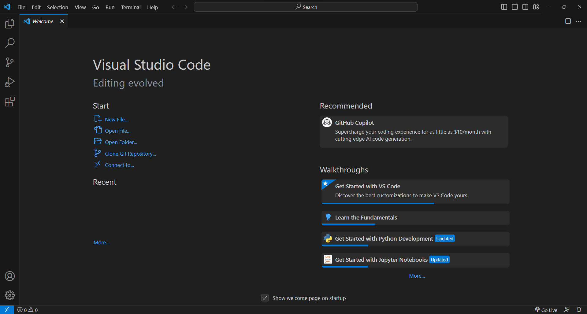
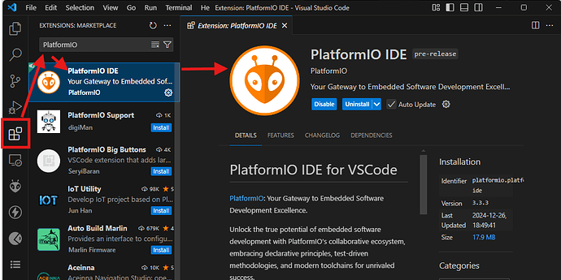
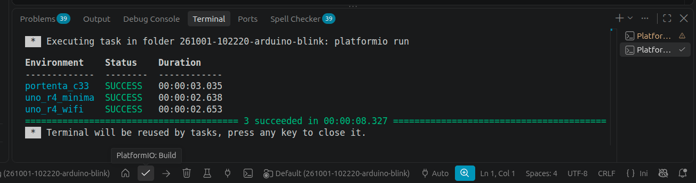

<!--
module_id: ecosystem
author:   David Croft
email:    david.croft@warwick.ac.uk
version: 0.0.1

language: en
narrator: UK English Female

mode: Textbook

title: Development Ecosystem
comment:  This module provides an overview of the development ecosystem for embedded systems programming, with a focus on the Arduino platform and Visual Studio Code as the primary development environment.

@learning_objectives  
    - Understand the components of the development ecosystem for embedded systems programming.
    - Familiarize with the Arduino platform and its features.
    - Learn about Visual Studio Code and its advantages for software development.
@end

@style
.flex-container {
    display: flex;
    flex-wrap: wrap; /* Allows the items to wrap as needed */
    align-items: stretch;
    gap: 20px; /* Adds both horizontal and vertical spacing between items */
}

.flex-child { 
    flex: 1;
    margin-right: 20px; /* Adds space between the columns */
}

@media (max-width: 600px) {
    .flex-child {
        flex: 100%; /* Makes the child divs take up the full width on slim devices */
        margin-right: 0; /* Removes the right margin */
    }
}
@end

@version_history 

Previous versions: 

@end

import: https://raw.githubusercontent.com/dscroft/CodeRunner/master/README.md
import: https://raw.githubusercontent.com/liaTemplates/AVR8js/main/README.md

import: ../assets/macros.md
-->

# Development Ecosystem

This module assumes and recommends that you use the PlatformIO IDE within Visual Studio Code for your development work. 
You are free to chose other development environments if you wish but you are wholly responsible to adapting the supplied instructions and materials to your chosen alternative.


## Arduino

The Arduino platform is a popular open-source electronics platform based on easy-to-use hardware and software.
It consists of a range of microcontroller boards, such as the Arduino Uno, Nano, and Mega, which are designed for prototyping and development of embedded systems.

It's use in an industry context is often limited to prototyping and education as opposed to production.
However it's wide range of supporting libraries and large community make it an excellent choice for learning about embedded systems development, especially for those new to the field.

The Arduino software ecosystem does support a number of production grade microcontrollers such as the SAMD21, STM32 ESP8266 and ESP32. 
So transitioning to a more industry relevant microcontroller is supported down the line.

R4 Wifi
=======

This this module we will be primarily using the Arduino Uno R4 Wifi, which is the latest addition to the Arduino family and features a more powerful microcontroller and built-in Wi-Fi capabilities.
However alternative boards are available if needed.

The primary reason for choosing the R4 Wifi is its built in debugging capabilities. Although the built in wifi is a benefit.


## Visual Studio Code

Visual Studio Code (vscode) is a free, open-source code editor developed by Microsoft. 
It is widely used for various programming languages and offers a rich ecosystem of extensions that enhance its functionality. 
VS Code provides the standard features such as syntax highlighting, code completion, debugging tools, and integrated terminal support, making it an excellent choice for software systems development.

<div class="important">
<b style="color: rgb(var(--color-highlight));">Important note</b><br>

Vscode is open sourced under the MIT License and is available for Windows, macOS, and Linux.
However the default pre-compiled binaries of vscode include telemetry and other Microsoft services.
If you prefer to use a version of vscode without telemetry, you can use the open-source version called [VSCodium](https://vscodium.com/).
If you encounter anywhere that the instructions do not work with VSCodium please let the module leader know as materials have only been tested in VSCode.

</div>


### Installation

1. Visit the Visual Studio Code website and download the appropriate version for your platform.
    - [Download](https://code.visualstudio.com/Download).
2. Make sure that VSCode runs.



----------------------------------

Portable version
================

If you cannot install the software then it is possible to run Visual Studio Code as a [portable app](https://code.visualstudio.com/docs/setup/portable).
VScode is available via the software center on WMG machines, but installing extensions and configuring your preferences on new machines is generally time consuming.

This approach allows you to carry your installation on a USB stick, with extensions you are looking at about 2GB minimum.

1. Visit the Visual Studio Code website and download the version for your platform.
    - If on Windows you will need the correct .zip file (probably the x64 version).
    - If on Linux you will need the correct .tar.gz file (probably the x64 version).
    - I don't have a Mac and so am not clear on which file you need. If you figure it out send me a merge request with missing details.
    - [Download](https://code.visualstudio.com/Download).
2. Extract the contents to your desired location.
3. Open the directory you just extracted to and find the "Code" executable file.
4. Create a directory called "data" in the same location as the "Code" executable.
5. Run the "Code" executable.
  - Use as normal.


## PlatformIO

PlatformIO provides a powerful and user-friendly environment for embedded systems programming, with support for a wide range of microcontrollers.

It is separate and distinct from VSCode, but it can also integrate with it as an extension.


Justification
=================

We will be using PlatformIO within VSCode as our development environment for this module over the official Arduino IDE for several reasons:

- **Advanced Features**: VSCode offers advanced features such as intelligent code completion, debugging tools, and integrated terminal support, which can enhance the development experience and productivity.
- **Project Configuration**: PlatformIO uses a configuration file (`platformio.ini`) that allows you to easily manage project settings, dependencies, and build options. This can help streamline the development process and make it easier to share projects with others.
- **Generative Code**: Various VSCode extensions support generative AI code generation. Use of these tools can significantly speed up development and responsible use of these tools is increasingly expected in industry.
- **Version Control Integration**: VSCode has built-in support for version control systems like Git, which can help you manage changes to your code and collaborate with others more effectively. This module will introduce and *will require* version control for various aspects, including coursework submission.

While the official Arduino IDE is simpler and may be more approachable for beginners, it lacks many of the features needed to support professional software development practices that will be introduced in this module.

### Installation

Option 1 - Install from within VSCode.
=====================

1. Within your VSCode installation, open the Extensions view.
    - Ctrl+Shift+X
2. Search for "PlatformIO IDE".
3. Install.



Option 2 - Install from VSCode Marketplace
====================

1. Visit the Marketplace [website](https://marketplace.visualstudio.com/) (appstore).
2. Find [PlatformIO](https://marketplace.visualstudio.com/items?itemName=platformio.platformio-ide).
3. Follow instructions.


### Testing

The PlatformIO extension will not complete setup until you run it for the first time.
Follow these steps to check it is installed and working.

1. Open VSCode.
2. Open PlaformIO Extension.
    - The Alien/Ant head on the left-hand sidebar.
3. In the PIO Home, open "Project Examples".
4. Select arduino-blink under the "Renesas RA" category.
    - *Not* the one under the "ATmel AVR" or any other category.
    - It's probably near the bottom of the list.
5. Import.
    - Let it finish downloading and installing.
6. Click the "PlatformIO: Build" button on the bottom bar.
    - Looks like a tick.

If you made it through all these steps and everything was successful, you should see several "SUCCESS" messages in the terminal window.




## General C/C++ compiler

Although not the specific focus of the module we will be looking at how general purpose C/C++ development differs from embedded development.
For this reason it may be helpful for you to have a general purpose C/C++ compiler installed as well.

The best way to do this will vary depending on your OS and you can look that up for your specific system. 
But for the purposes of this module specifically we are going to recommend installing the "C C++ Toolkit" extension in order to keep consistency across student and university machines.
This extension will install the GCC (GNU C Compiler) alongside various additional development tools.

### Installation

Option 1 - Install from within VSCode.
=====================

1. Within your VSCode installation, open the Extensions view.
    - Ctrl+Shift+X
2. Search for "C C++ Toolkit".
    - Published by "Usman Mehmood" at cpptoolkit.com.
3. Install.

Option 2 - Install from VSCode Marketplace
====================

1. Visit the Marketplace [website](https://marketplace.visualstudio.com/) (appstore).
2. Find [C C++ Toolkit](https://marketplace.visualstudio.com/items?itemName=UsmanMehmood.c-toolkit).
3. Follow instructions.


### Testing

The Toolkit extension will not complete setup until you run it for the first time.
Follow these steps to check it is installed and working.

1. Open VSCode.
2. Create a new C++ project.
    - Open the Command Palette (ctrl+shift+p).
    - Search for "C C++ Toolkit: Create New C++ Project".
3. Follow the instructions to complete installation, select a base folder and name your project.
4. Once the project has been created, build it.
    - Open the Command Palette (ctrl+shift+p).
    - Search for "CMake: Build".
    - *Or*, click on the "Build" button in the bottom left corner of VSCode.


If you made it through all these steps and everything was successful, a "[build] Build finished with exit code 0" message in the Output window


# Version Control

Version control is a system that records changes to files over time so that you can recall specific versions later.
It is an essential tool for software development, allowing developers to track changes, collaborate with others,

The specifics of version control will be covered later in module, but we will be using Git on this module.

- You will be required to upload your coursework to an online Git repository. 
- You are not required to use any specific repository hosting service.

mygit.wmg.warwick.ac.uk
=========================

WMG has an [institutional instance](https://mygit.wmg.warwick.ac.uk/) that you can use for this purpose, but you are free to use any online hosting service such as GitHub or GitLab if you prefer.

- You will need to reach out to your module leader for them to create your Warwick git account.

github.com
==========

Github is the more commonly used hosting service however and if you would prefer to use that then you can.

- Using Github does have the benefit that you will not loose access when your course finishes and can start to develop a portfolio of work.


<div class = "cool-fact">
<b style="color: rgb(var(--color-highlight));">Free!</b><br>

While you are in education, Github will give you a free [Pro account](https://github.com/education/students) that includes unlimited private repositories and extra features. 
This is normally a paid service but you are signing up with a 3rd party (GitHub), so please read their terms of service and privacy policy carefully before signing up.

</div>


# AI Coding agents

You are free to use AI coding agents such as Copilot for certain aspects of this module subject to documentation requirements which will be specified.
However it is not required.

As such the specific agents that you may choose to use are up to you.
This module will not be supplying licenses for specific agents.
If you choose to use an agent, then there is almost certainly an extension to integrate them with your VSCode environment.
For example if you have signed up for a Github education account and have access to Copilot, then you can install the [Copilot extension](https://marketplace.visualstudio.com/items?itemName=GitHub.copilot).

Alternatively you can run your own local agents using Ollama and integrate with VSCode .


# LiaScript

The lab materials for the course are written in LiaScript, i.e. this is written in LiaScript.
If you want to look into Markdown based presentation systems then feel free but it's not directly relevant to this module with the possible exception of writing the documentation for your Git repositories.

-----------------------------

LiaScript has a number of useful capabilities.

- Navigation between pages can be done using the keyboard keys or the arrow buttons at the base of the page.
  - If you are on mobile you may need to scroll down to see them (e.g. Firefox mobile).
- Search and navigation is available via the Table of contents <i class="icon icon-table lia-btn__icon"></i>
- Alternative colour schemes, including dark mode as available via Settings <i class="icon icon-settings lia-btn__icon"></i>
- Translations are available via the Translations button but absolutely **no** claims of accuracy are made.

## Tasks

As you work through the materials you will encounter tasks to be completed.
These tasks will be generally be tagged using the same traffic light system as the Lecture slides.

<div class="pass-task">
@boxheader(Core task)

This is a core task, you *really* want to be able to do all of these.
</div>

<div class="good-task">
@boxheader(Intermediate task)

This is an intermediate task, if you want a good mark you'll be able to do all of these.
</div>

<div class="adv-task">
@boxheader(Advanced task)

This is an advanced task, you do not need to be able to do this in order to pass the module.
That said, understanding of these topics may be helpful in later modules.
</div>

## Code examples

Some of the materials will include active and/or passive code examples.


Passive Example
===============
<section class="flex-container">
<div class="flex-child" style="min-width:500px">
```cpp
int main()
{
  std::cout << "Hello World!" << std::endl;
  return 0;
}
```
</div>
<div class="flex-child">
- Can copied to the clipboard using the <i class="icon icon-copy lia-btn__icon"></i> button.
</div>
</section>


Active Example
===============
<section class="flex-container">
<div class="flex-child" style="min-width:500px">
```cpp
int main()
{
  std::cout << "Hello World!" << std::endl;
  return 0;
}
```
@LIA.cpp()
</div>
<div class="flex-child">
- Can be generally be edited by you.
- Can be run in the browser.
  - Press the <i class="icon icon-compile-circle lia-btn__icon"></i> button
- If you edit the code you can view the different versions using the <i class="icon icon-chevron-left lia-btn__icon"></i> <i class="icon icon-chevron-right lia-btn__icon"></i> arrows 
</div>
</section>

<section class="flex-container">
<div class="flex-child pass-task">
@boxheader(In the browser)

Run the active task demo and see what happens.
</div>
<div class="flex-child good-task">
@boxheader(In the browser)

Break the code and try running it, what happens?

If not sure how to break it, just try deleting some random bits.
</div>
</section>


## Arduino code examples

The previous examples were for general C/C++. 
They were compiled for a x64 Ubuntu system not an embedded device.
You will encounter some active examples for Arduino code, these will however be rarer as we are limited in our ability to simulate hardware interactions.

Arduino examples will generally be obvious as they include `void setup()` and `void loop()` functions, the purpose of which will be covered later.

<div id="simple-demo">
  <wokwi-led color="red" pin="11"></wokwi-led>
</div>
```cpp Simple Arduino example
constexpr uint8_t ledPin = 11;

void setup() 
{
  Serial.begin(9600);
  pinMode(ledPin, OUTPUT);
}

void loop() 
{
  static bool state = HIGH;                // store state

  digitalWrite( ledPin, state );           // set led
  Serial.println( state ? "ON" : "OFF" );  // print message

  state = !state;                          // flip state

  delay(3000);                             // wait 3s
}
```
@AVR8js.sketch(simple-demo)

<div class="pass-task">
@boxheader(In the browser)

Try running the Arduino example, what happens?

*Hint: watch the LED* 

<wokwi-led color="red" pin="11"></wokwi-led>

</div>

# Checklist

If using your own computer
============================

1. Install Visual Studio Code.
2. Install the PlatformIO extension in Visual Studio Code.
3. Install the C C++ Toolkit extension in Visual Studio Code.
4. Check that the software works.

Everyone
========

1. Create account on an online Git repository hosting service (e.g. WMG's MyGit, GitHub or GitLab).
2. Collect your Arduino Uno R4 Wifi and accessories.
   